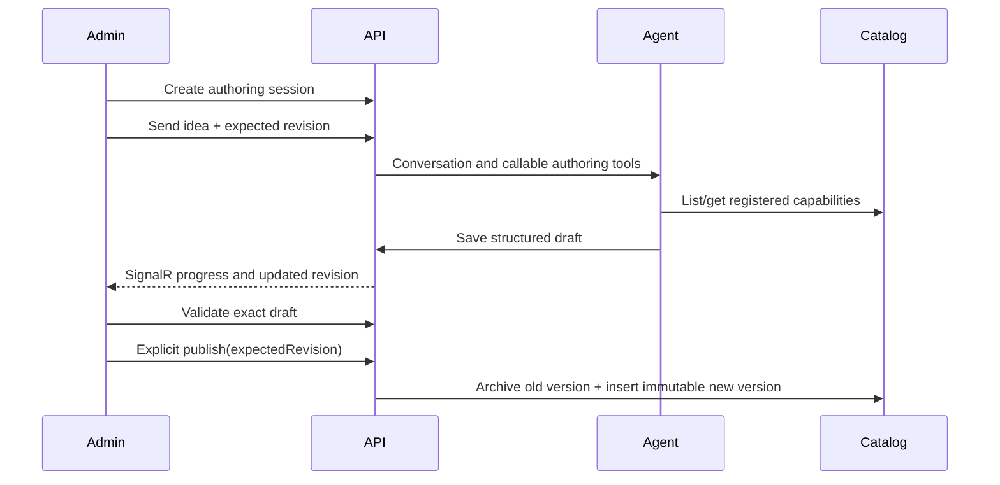

# Preset Authoring Backend

## Purpose

The backend now treats presets as administrator-authored catalog products, not C# seed data. An authenticated admin discusses an idea with the authoring agent, which discovers registered capabilities and incrementally saves a structured draft. Validation is deterministic. Publication is always a separate human action.

## Draft contract

`PresetDraftDocument` contains public metadata, JSON input schema, optional `arzly.report` v4 result contract, background-execution policy, agents and Harness settings, workflow nodes/connections, and admin-only notes. Node keys are stable lowercase slugs. Mappings use stable keys rather than database IDs or array positions:

- `$.inputs.topic` or optional `$.inputs.recipient?`
- `$.nodes.writer.output`
- `$.nodes.review.approvedOutput`
- `$.literal.some-value`

The agent may call `list_capabilities`, `get_capability_details`, `save_preset_draft`, and `validate_preset_draft`. It cannot call a publication tool.

Validation blocks publication when metadata or JSON is invalid; the model/capability is not registered; temperature or web search is unsupported; a required capability input is unmapped; the graph is disconnected, cyclic, or lacks one entry/terminal; a mapping references a non-upstream node; approval regeneration has no unambiguous upstream agent; or the background policy is inconsistent. Unavailable capabilities are errors, never silently omitted.

## Capabilities

`CapabilityCatalogSeed` idempotently records the building blocks the agent may use:

| Kind | Keys |
| --- | --- |
| Connector | `google`, `linkedin` |
| Integration | `google.sheets.read`, `google.sheets.write`, `google.sheets.report`, `google.tasks.create`, `google.calendar.create-events`, `google.gmail.send-html`, `linkedin.posts` |
| Operation | `decision.weighted-score`, `receipt.analyze` |

Each integration describes input/output schemas, credential fields, OAuth scopes, required provider APIs, documentation links, risk, and background compatibility. Startup fails when enabled integration/operation metadata has no registered runtime handler. Capability code remains backend-owned; Nango is not used.

## Versioning and visibility

Publishing requires the current `ExpectedRevision`. Version 1 is inserted as `Published`. A later publication for the same key inserts the next version and atomically archives the former published version. Published records are not edited in place. Clone an old version into a new authoring session to revise it.

The public `/api/v1/presets` endpoints return only the currently published version and exclude admin notes. Protected admin endpoints can inspect published and archived versions. Background policy is descriptive data for Flutter; the backend does not schedule user workflows or deliver local notifications.

## Configuration

The administrator is seeded from `backend/src/ArzlyAI.Api/appsettings.json`. Do not commit a real password when the repository is shared publicly.

| Setting | Purpose |
| --- | --- |
| `Jwt:Key` | JWT HMAC signing key, minimum 32 characters |
| `Jwt:Issuer`, `Jwt:Audience`, `Jwt:ExpirationMinutes` | JWT issuer, audience, and access-token lifetime |
| `RefreshToken:ExpirationDays` | Refresh-token lifetime |
| `AdminSeed:Id`, `AdminSeed:Email`, `AdminSeed:Password`, `AdminSeed:DisplayName` | The one Identity administrator created on first startup |
| `AdminAuthoring:DefaultProvider`, `AdminAuthoring:DefaultModel` | Initial assistant selection for newly created and cloned authoring sessions |
| `AdminAuthoring:Providers:<provider>:Enabled` | Enables one supported server-owned provider: `openai`, `anthropic`, `gemini`, or `deepseek` |
| `AdminAuthoring:Providers:<provider>:ApiKey` | Server-owned provider key used only for the protected admin authoring assistant |

The seed runs only when the configured stable Identity ID does not exist. It hashes the configured password with Identity and never resets an existing password. Access tokens live for 60 minutes by default. Refresh tokens are opaque, SHA-256 hashed in PostgreSQL, rotated on use, and returned in the login/refresh JSON response. The React admin keeps them in session storage.

The authoring model is selected per session and stored as provider/model metadata only—never as a provider key. `GET /api/v1/admin/authoring/assistant-models` queries only enabled, configured providers and returns only models that pass the backend's function-calling capability policy. Each provider adapter exposes the same controlled tools: capability listing/details, draft saving, and validation. The assistant cannot publish a preset. Provider keys are never returned, persisted in authoring sessions, or logged.

## Exact implementation files

- Domain: `Entities/Authoring/`, `Entities/Integrations/ConnectorDefinition.cs`, `WorkflowOperationDefinition.cs`, and preset publication fields.
- Application: `Models/Authoring/`, `Services/Authoring/`, `Services/Admin/`, and `Repositories/Authoring/`.
- Infrastructure: `Identity/ApplicationUser.cs`, `Identity/ApplicationRole.cs`, Identity auth/seeding services, `Agents/Authoring/`, authoring repositories, `CapabilityCatalogSeed.cs`, and `CapabilityCatalogValidator.cs`.
- API: `Controllers/Admin/`, `Hubs/AdminAuthoringHub.cs`, `Realtime/SignalRAuthoringRealtimeNotifier.cs`, and `Helpers/DIContainer.cs`.
- Database: migrations `20260905163036_AdminAuthoredPresetCatalog`, `20260905171755_ReplaceCustomAdminAuthWithIdentity`, `20260905174923_AddAuthoringAssistantModelSelection`, and `ArzlyDbContextModelSnapshot.cs`.
- Tests: `CapabilityCatalogSeedTests.cs`, `PresetDraftValidatorTests.cs`, `PresetCatalogMigrationTests.cs`, and `AuthoringModelCatalogServiceTests.cs`.
