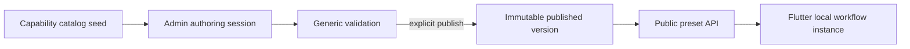

# Preset Catalog Migration

## Outcome

Migration `20260905163036_AdminAuthoredPresetCatalog` replaces source-seeded presets with an admin-authored, versioned catalog. It deletes only the known legacy keys; it does not truncate catalog or capability tables. Startup cannot recreate those presets because their seed calls and seed classes were removed.

Deleted keys:

- `daily-linkedin-ai-post`, `smart-purchase-decision`, `brain-dump-to-action`, `receipt-intelligence`
- `receipt-monthly-spending`, `receipt-weekly-budget`, `receipt-quarterly-tax`, `receipt-yearly-review`
- `receipt-category-dive`, `receipt-anomaly-detector`, `receipt-savings-tracker`

## New ownership model

PostgreSQL stores reusable capabilities, the ASP.NET Core Identity administrator, authoring conversations/drafts, and immutable published preset versions. Flutter still owns end-user runs, schedules, history, and credentials. No background scheduler or notification ownership moved to the backend.



Publishing a key for the first time creates version 1. Publishing another valid draft with the same key creates the next version, archives the previously published version, and records `SupersedesPresetId` in one transaction. Archived versions remain visible to protected admin endpoints, never to the public preset catalog.

## Applying and checking

```powershell
dotnet ef database update --project backend/src/ArzlyAI.Infrastructure --startup-project backend/src/ArzlyAI.Api --context ArzlyDbContext
dotnet run --project backend/src/ArzlyAI.Api/ArzlyAI.Api.csproj
```

After migration, `GET /api/v1/presets` returns an empty collection until an admin publishes a valid draft. Startup still idempotently seeds provider/model and capability metadata.

## Administrator identity follow-up

Migration `20260905171755_ReplaceCustomAdminAuthWithIdentity` immediately follows this catalog migration. It replaces the temporary custom administrator tables with ASP.NET Core Identity tables and intentionally removes any account, invitation, and refresh-session data stored in those old tables. The first administrator is created once from `AdminSeed` configuration; its password is hashed by Identity and is not reset on later startups. See `docs/admin/react-admin-contract.md` for the JSON access/refresh-token contract.
