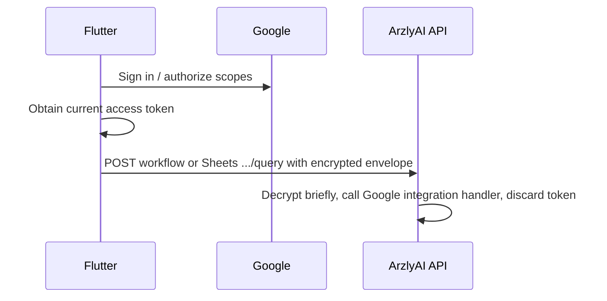

# Native Google Authorization (Flutter)

ArzlyAI no longer brokers Google OAuth through the backend. Flutter signs the user into one Google account with `google_sign_in`, requests service scopes incrementally, and sends short-lived access tokens to the backend only inside encrypted credential envelopes when a workflow or Google Sheets resource query runs.

LinkedIn remains unavailable until a separate connector strategy ships.

## Google Cloud setup

Create OAuth clients in the same Google Cloud project that enables Sheets, Drive, Gmail, Tasks, and Calendar APIs.

### Android

| Item | Value |
| --- | --- |
| Package name | `com.arzlyai.arzlyai_mobile` |
| Client type | Android |
| Android client ID | `989009017147-dtthjs439btoa659cknopnrcpmjvdh1b.apps.googleusercontent.com` |
| Debug SHA-1 | `96:7B:CF:EA:C4:50:AE:B6:D7:87:B7:21:43:BB:69:FD:51:A2:91:9C` |
| Debug SHA-256 | `95:93:7F:3A:9F:98:75:B6:6A:ED:8F:FD:7B:B6:64:DB:A9:7A:4A:66:6F:36:03:30:EE:F4:02:27:2D:13:0C:A5` |

The Android client stays in Google Cloud and is matched through the package name and signing certificate. Its client ID is not copied into Flutter.

Flutter passes this public Web client ID to `GoogleSignIn.initialize(serverClientId: ...)` on Android:

```text
989009017147-1a88ljaaa8t8dpm19lj0ea13c74fn5j7.apps.googleusercontent.com
```

It is the default in `google_auth_config.dart`, so the normal development command needs no Google-specific argument. No client secret belongs in the mobile app or backend.

Override the Web client ID for another environment with:

```text
--dart-define=GOOGLE_SERVER_CLIENT_ID=<web-client-id>.apps.googleusercontent.com
```

### iOS

| Item | Value |
| --- | --- |
| Client type | iOS |
| Bundle ID | Match the Xcode bundle identifier |
| Reversed client ID URL scheme | Add to `Info.plist` (`CFBundleURLTypes`) |

Build with:

```text
--dart-define=GOOGLE_IOS_CLIENT_ID=<ios-client-id>.apps.googleusercontent.com
```

## Authorization model

One Google account serves every Google integration:

| Connector | Scopes |
| --- | --- |
| Google Sheets | `spreadsheets`, `drive.metadata.readonly` |
| Gmail | `gmail.send` |
| Google Tasks | `tasks` |
| Google Calendar | `calendar.events` |

## Google Auth Platform data access

Under **Google Auth Platform -> Data Access**, add the following scopes for the
current preset catalog. The three identity scopes support native Google Sign-In
and account display. The remaining scopes are requested incrementally only when
a preset needs the corresponding connector.

| Select | Full OAuth scope | Used for |
| --- | --- | --- |
| Yes | `openid` | Identify the selected Google account. |
| Yes | `https://www.googleapis.com/auth/userinfo.email` | Obtain the account email used by Gmail delivery. |
| Yes | `https://www.googleapis.com/auth/userinfo.profile` | Display basic account identity. |
| Yes | `https://www.googleapis.com/auth/spreadsheets` | Read receipt data and write receipt reports. |
| Yes | `https://www.googleapis.com/auth/drive.metadata.readonly` | List spreadsheet IDs and names through Drive `files.list`; it does not read file content. |
| Yes | `https://www.googleapis.com/auth/tasks` | Create task lists, tasks, and subtasks. |
| Yes | `https://www.googleapis.com/auth/calendar.events` | Create and update calendar events without managing calendar settings. |
| Yes | `https://www.googleapis.com/auth/gmail.send` | Send generated HTML reports and action-plan emails. |

Do not add broader scopes such as `drive`, `drive.readonly`, `calendar`,
`gmail.modify`, or `mail.google.com`; the current integrations do not need them.
The `drive.metadata.readonly` scope is needed by the current in-app spreadsheet
browser. A future Google Picker implementation should replace it with the
narrower `drive.file` scope before production verification.

Official scope references:

- [Google Sheets scopes](https://developers.google.com/workspace/sheets/api/scopes)
- [Google Drive scopes](https://developers.google.com/workspace/drive/api/guides/api-specific-auth)
- [Google Tasks scopes](https://developers.google.com/workspace/tasks/auth)
- [Google Calendar event authorization](https://developers.google.com/workspace/calendar/api/v3/reference/events/insert)
- [Gmail scopes](https://developers.google.com/workspace/gmail/api/auth/scopes)

## Required enabled APIs

Enable all five APIs in the same Google Cloud project as the Android and Web
OAuth clients:

| API | Current usage |
| --- | --- |
| Google Sheets API | Read receipt ranges and write report tabs. |
| Google Drive API | Discover spreadsheets for the resource selector. |
| Gmail API | Send HTML email. |
| Google Tasks API | Create task lists, tasks, and subtasks. |
| Google Calendar API | Insert action-plan events. |

Adding a scope under Data Access does not enable its API and does not update an
already-issued access token. After enabling an API or adding a scope, disconnect
and reconnect the Google account during testing.

## Capability scope matrix

The backend capability catalog is the source of truth. Admin-authored presets inherit requirements from the integration keys they select.

| Capability | Required Google scopes |
| --- | --- |
| `google.sheets.read` | `spreadsheets`, plus `drive.metadata.readonly` for spreadsheet discovery. |
| `google.sheets.write`, `google.sheets.report` | `spreadsheets`. |
| `google.tasks.create` | `tasks`. |
| `google.calendar.create-events` | `calendar.events`. |
| `google.gmail.send-html` | `gmail.send`. |

Settings exposes a single **Google account** screen:

1. Sign in to Google natively.
2. Authorize each service when needed.
3. Disconnect removes the entire Google account connection from the device.

Individual service rows do not revoke scopes independently.

## Runtime flow



Envelope keys:

| Key | Required for |
| --- | --- |
| `google.accessToken` | All Google integrations |
| `google.email` | Gmail send integration only |

Flutter does **not** persist Google access tokens, refresh tokens, or expiry timestamps. Background scheduled runs may restore authorization silently; if user interaction is required, the run is skipped and the existing tap-to-run notification asks the user to reopen the app.

Each workflow supplies its active integration keys along with its envelope-field requirements. Flutter evaluates preset node conditions, combines only the scopes needed for those integrations, and requests one access token for that scope union.

## Backend endpoints retained

Only stateless Google Sheets metadata queries remain under `/api/v1/connectors/google-sheets/resources/.../query`. Connector session, status, callback, credentials, refresh, and delete routes were removed.

## Mobile files

- `mobile/arzlyai_mobile/lib/core/google/google_auth_config.dart`
- `mobile/arzlyai_mobile/lib/core/google/google_auth_scopes.dart`
- `mobile/arzlyai_mobile/lib/data/repositories/google/google_native_auth_repository.dart`
- `mobile/arzlyai_mobile/lib/data/providers/google/google_auth_provider.dart`
- `mobile/arzlyai_mobile/lib/ui/features/settings/settings_google_account_screen.dart`
- `mobile/arzlyai_mobile/test/repositories/google_native_auth_repository_test.dart`

## Backend files

- `backend/src/ArzlyAI.Api/Controllers/v1/ConnectorsController.cs`
- `backend/src/ArzlyAI.Infrastructure/Persistence/Seeds/CapabilityCatalogSeed.cs`
- `backend/tests/ArzlyAI.Tests/CapabilityCatalogSeedTests.cs`
