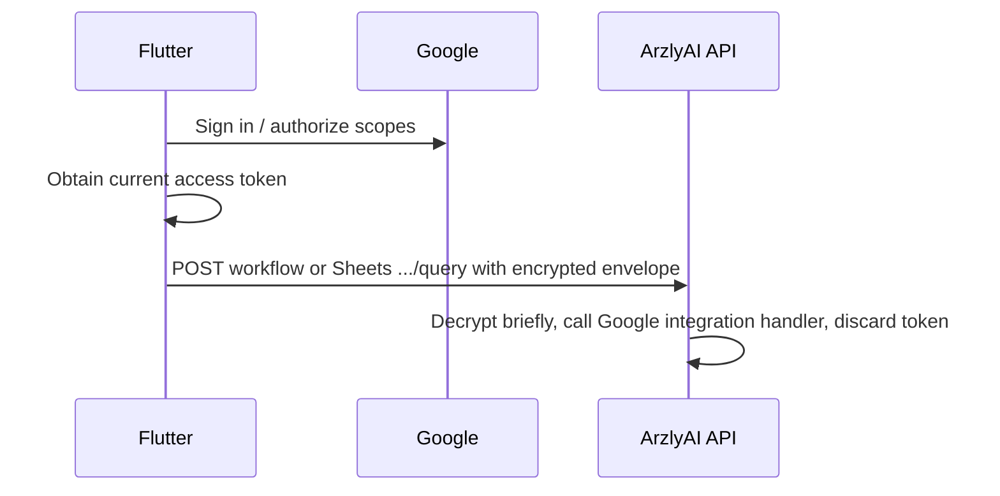

# Native Google Authorization (Flutter)

ArzlyAI no longer brokers Google OAuth through the backend. Flutter signs the user into one Google account with `google_sign_in`, requests service scopes incrementally, and sends short-lived access tokens to the backend only inside encrypted credential envelopes when a workflow or Google Sheets resource query runs.

LinkedIn remains unavailable until a separate connector strategy ships.

## Google Cloud setup

Create OAuth clients in the same Google Cloud project that enables Sheets, Drive, Gmail, Tasks, and Calendar APIs.

### Android

| Item | Value |
| --- | --- |
| Package name | `com.arzlyai.arzlyai_mobile` |
| Client type | Android |
| SHA-1 / SHA-256 | Register debug and release signing certificate fingerprints from your keystore |

Also create a **Web application** OAuth client. Flutter passes its client ID to `GoogleSignIn.initialize(serverClientId: ...)` on Android. No client secret belongs in the mobile app.

Build with:

```text
--dart-define=GOOGLE_SERVER_CLIENT_ID=<web-client-id>.apps.googleusercontent.com
```

### iOS

| Item | Value |
| --- | --- |
| Client type | iOS |
| Bundle ID | Match the Xcode bundle identifier |
| Reversed client ID URL scheme | Add to `Info.plist` (`CFBundleURLTypes`) |

Build with:

```text
--dart-define=GOOGLE_IOS_CLIENT_ID=<ios-client-id>.apps.googleusercontent.com
```

## Authorization model

One Google account serves every Google integration:

| Connector | Scopes |
| --- | --- |
| Google Sheets | `spreadsheets`, `drive.metadata.readonly` |
| Gmail | `gmail.send` |
| Google Tasks | `tasks` |
| Google Calendar | `calendar.events` |

Settings exposes a single **Google account** screen:

1. Sign in to Google natively.
2. Authorize each service when needed.
3. Disconnect removes the entire Google account connection from the device.

Individual service rows do not revoke scopes independently.

## Runtime flow



Envelope keys:

| Key | Required for |
| --- | --- |
| `google.accessToken` | All Google integrations |
| `google.email` | Gmail send integration only |

Flutter does **not** persist Google access tokens, refresh tokens, or expiry timestamps. Background scheduled runs may restore authorization silently; if user interaction is required, the run is skipped and the existing tap-to-run notification asks the user to reopen the app.

## Backend endpoints retained

Only stateless Google Sheets metadata queries remain under `/api/v1/connectors/google-sheets/resources/.../query`. Connector session, status, callback, credentials, refresh, and delete routes were removed.

## Mobile files

- `mobile/arzlyai_mobile/lib/core/google/google_auth_config.dart`
- `mobile/arzlyai_mobile/lib/core/google/google_auth_scopes.dart`
- `mobile/arzlyai_mobile/lib/data/repositories/google/google_native_auth_repository.dart`
- `mobile/arzlyai_mobile/lib/data/providers/google/google_auth_provider.dart`
- `mobile/arzlyai_mobile/lib/ui/features/settings/settings_google_account_screen.dart`
- `mobile/arzlyai_mobile/test/repositories/google_native_auth_repository_test.dart`

## Backend files

- `backend/src/ArzlyAI.Api/Controllers/v1/ConnectorsController.cs`
- `backend/src/ArzlyAI.Infrastructure/Persistence/Seeds/GoogleIntegrationSchemaSeed.cs`
- `backend/tests/ArzlyAI.Tests/GoogleIntegrationSchemaSeedTests.cs`
