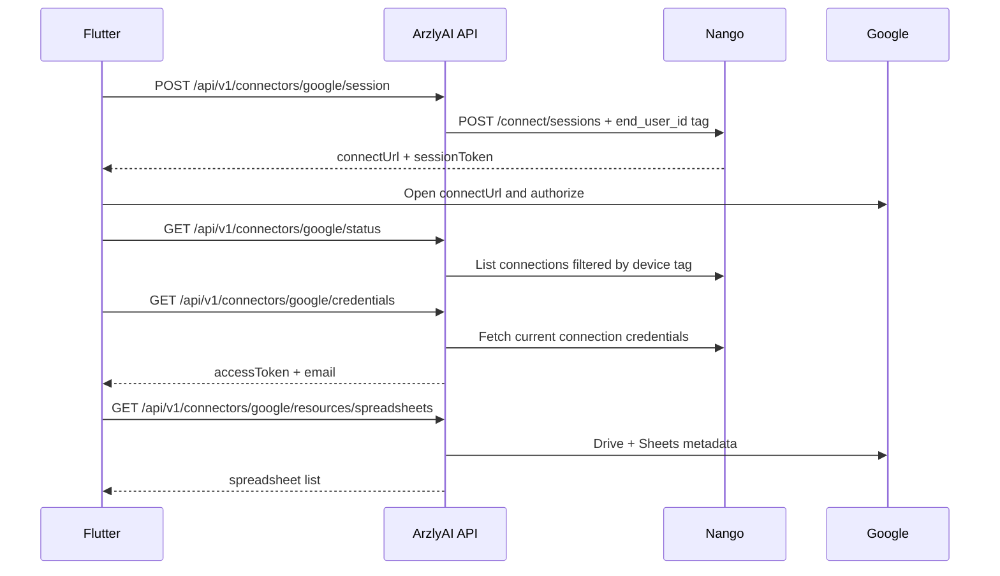

# Nango Google Connector

ArzlyAI uses Nango to broker Google OAuth for Sheets read/write, Drive spreadsheet listing, and Gmail HTML send. The backend stores neither OAuth tokens nor device connections. Every connect session is tagged with the mobile-generated device UUID; connections and credentials resolve from Nango on demand.

Receipt preset architecture: [`../presets/receipt-automation.md`](../presets/receipt-automation.md).

## Configuration

Set these values through environment variables or user secrets:

```text
Nango__ApiKey=<environment API key>
Nango__BaseUrl=https://api.nango.dev
Nango__GoogleIntegrationId=google
```

The Nango API key needs the same environment permissions as the LinkedIn connector:

- `environment:connect_sessions:write`
- `environment:connections:list`
- `environment:connections:read_credentials`
- `environment:connections:delete`

Configure the Google integration in Nango with OAuth scopes that cover the APIs ArzlyAI calls:

| Scope | Used for |
| --- | --- |
| `https://www.googleapis.com/auth/spreadsheets` | Read receipt ranges and write report tabs |
| `https://www.googleapis.com/auth/drive.readonly` | List spreadsheets in Drive (`GoogleSheetsClient.ListSpreadsheetsAsync`) |
| `https://www.googleapis.com/auth/gmail.send` | Send HTML report emails |
| `openid` | OAuth identity |
| `email` | Populate `google.email` credential field |
| `profile` | Standard profile claims |

Nango's default callback is `https://api.nango.dev/oauth/callback`. Production may use a configured custom callback. Mobile deep link: `arzlyai://oauth/google` (`ConnectorOAuthConfig.googleRedirectUri`).

## Mobile flow

Mobile generates a random UUID once, stores it locally, and supplies it as `X-Device-Id` on every request.



| Method | Endpoint | Successful response |
| --- | --- | --- |
| `POST` | `/api/v1/connectors/google/session` | `200` session URL, token, and expiry |
| `GET` | `/api/v1/connectors/google/status` | `200` connection status |
| `GET` | `/api/v1/connectors/google/credentials` | `200` mapped keys or `404` |
| `DELETE` | `/api/v1/connectors/google` | `204` disconnected or `404` |
| `GET` | `/api/v1/connectors/google/resources/spreadsheets` | `200` spreadsheet list |
| `GET` | `/api/v1/connectors/google/resources/spreadsheets/{id}/tabs` | `200` tab list |
| `GET` | `/api/v1/connectors/google/resources/spreadsheets/{id}/tabs/{title}/headers` | `200` header row |

Google credential response:

```json
{
  "google.accessToken": "<access-token>",
  "google.email": "user@example.com"
}
```

Mobile syncs these fields into platform secure storage and `connector_credentials` for workflow envelope assembly. Tokens are never written to receipt workflow inputs or logs.

## Security and limitations

- Nango API keys and OAuth tokens are never logged.
- PostgreSQL remains a public preset catalog and stores no connector state.
- Nango refreshes an expired token when the connection is fetched.
- Status uses polling; an auth webhook is not implemented.
- A device UUID provides routing, not authenticated identity. Anyone who obtains it could query that device's connector endpoints.
- Spreadsheet listing is capped at 100 Drive files ordered by modified time.
- Receipt reads are bounded to 1000 rows per run.
- Gmail sends from the connected account; `google.email` is used for display and envelope metadata only.

## Exact backend files

| File | Purpose |
| --- | --- |
| `backend/src/ArzlyAI.Api/Controllers/v1/ConnectorsController.cs` | Connector and Google resource HTTP endpoints |
| `backend/src/ArzlyAI.Application/Services/Connectors/IConnectorBroker.cs` | Provider-independent connector contract |
| `backend/src/ArzlyAI.Application/Services/Connectors/IGoogleResourceService.cs` | Spreadsheet metadata use cases |
| `backend/src/ArzlyAI.Application/Services/Connectors/GoogleResourceService.cs` | Resource orchestration |
| `backend/src/ArzlyAI.Infrastructure/Connectors/Nango/NangoConnectorBroker.cs` | Google field mapping (`google.accessToken`, `google.email`) |
| `backend/src/ArzlyAI.Infrastructure/Connectors/Nango/NangoConnectorClient.cs` | Nango REST adapter |
| `backend/src/ArzlyAI.Infrastructure/Configuration/NangoOptions.cs` | `GoogleIntegrationId` binding |
| `backend/src/ArzlyAI.Infrastructure/Integrations/Google/GoogleSheetsClient.cs` | Drive/Sheets API |
| `backend/src/ArzlyAI.Infrastructure/Integrations/Google/GmailClient.cs` | Gmail send API |
| `backend/src/ArzlyAI.Api/Helpers/DIContainer.cs` | HttpClient, broker, Google clients |
| `backend/tests/ArzlyAI.Tests/NangoConnectorBrokerTests.cs` | Session, mapping, disconnect tests |
| `backend/tests/ArzlyAI.Tests/GoogleIntegrationTests.cs` | Sheets report and Gmail handler tests |

## Mobile files

| File | Purpose |
| --- | --- |
| `mobile/arzlyai_mobile/lib/core/credentials/connector_keys.dart` | `ConnectorKeys.google` |
| `mobile/arzlyai_mobile/lib/core/credentials/connector_oauth_config.dart` | OAuth redirect URI |
| `mobile/arzlyai_mobile/lib/data/repositories/connectors/connector_repository.dart` | Nango session/status/credentials |
| `mobile/arzlyai_mobile/lib/data/repositories/connectors/google_resource_repository.dart` | Spreadsheet metadata |
| `mobile/arzlyai_mobile/lib/ui/features/settings/settings_google_connector_screen.dart` | Settings UI |
| `mobile/arzlyai_mobile/lib/ui/shared/widgets/app_google_sheet_selector.dart` | Sheet picker widget |
