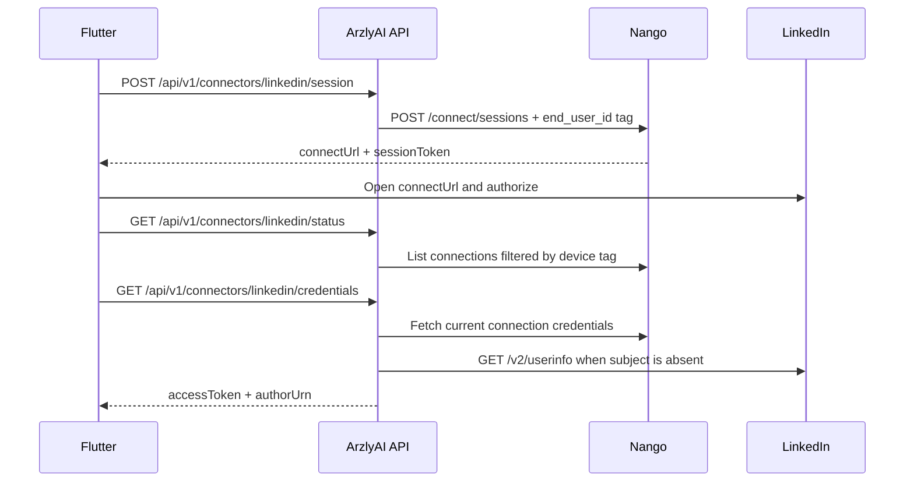

# Nango LinkedIn Connector

For the Flutter implementation handoff, use the copy-ready
[`flutter-nango-connector-prompt.md`](flutter-nango-connector-prompt.md).

ArzlyAI uses Nango as an OAuth broker while preserving its no-registration model. The backend stores neither OAuth tokens nor device connections. It tags every Nango connect session with the mobile-generated device UUID and resolves connections from Nango on demand.

## Configuration

Set these values through environment variables or user secrets:

```text
Nango__ApiKey=<environment API key>
Nango__BaseUrl=https://api.nango.dev
Nango__LinkedInIntegrationId=linkedin
```

The Nango API key needs:

- `environment:connect_sessions:write`
- `environment:connections:list`
- `environment:connections:read_credentials`
- `environment:connections:delete`

Configure the LinkedIn integration with `openid profile w_member_social`. Nango's default callback is `https://api.nango.dev/oauth/callback`; production may use a configured custom callback.

## Mobile flow

Mobile generates a random UUID once, stores it locally, and supplies it as `X-Device-Id` on every request.



| Method | Endpoint | Successful response |
| --- | --- | --- |
| `POST` | `/api/v1/connectors/{connectorKey}/session` | `200` session URL, token, and expiry |
| `GET` | `/api/v1/connectors/{connectorKey}/status` | `200` connection status |
| `GET` | `/api/v1/connectors/{connectorKey}/credentials` | `200` mapped keys or `404` |
| `DELETE` | `/api/v1/connectors/{connectorKey}` | `204` disconnected or `404` |

LinkedIn credential response:

```json
{
  "linkedin.accessToken": "<access-token>",
  "linkedin.authorUrn": "urn:li:person:<sub>"
}
```

Mobile stores these values locally and later sends a new encrypted credential envelope only when accepting/publishing. Requesting an AI edit uses `openai.apiKey`, not LinkedIn credentials.

## Security and limitations

- Nango API keys and OAuth tokens are never logged.
- PostgreSQL remains a public preset catalog and stores no connector state.
- Nango refreshes an expired token when the connection is fetched.
- Status uses polling; an auth webhook is not implemented.
- A device UUID provides routing, not authenticated identity. Anyone who obtains it could query that device's connector endpoints. A future device-bound proof/signature is required before treating this as a hardened multi-tenant internet service.
- Only `linkedin` credential mapping is implemented; the broker shape supports additional connectors later.

## Exact backend files

| File | Purpose |
| --- | --- |
| `backend/src/ArzlyAI.Api/Controllers/v1/ConnectorsController.cs` | Versioned device-scoped HTTP endpoints. |
| `backend/src/ArzlyAI.Application/Services/Connectors/IConnectorBroker.cs` | Provider-independent connector use-case contract. |
| `backend/src/ArzlyAI.Application/DTOs/Connectors/` | Session and status responses. |
| `backend/src/ArzlyAI.Infrastructure/Connectors/Nango/NangoConnectorBroker.cs` | Connector orchestration and LinkedIn field mapping. |
| `backend/src/ArzlyAI.Infrastructure/Connectors/Nango/NangoConnectorClient.cs` | Nango REST adapter. |
| `backend/src/ArzlyAI.Infrastructure/Connectors/LinkedIn/LinkedInIdentityClient.cs` | OpenID userinfo subject fallback. |
| `backend/src/ArzlyAI.Infrastructure/Configuration/NangoOptions.cs` | Configuration binding. |
| `backend/src/ArzlyAI.Api/Helpers/DIContainer.cs` | HttpClient, broker, options, and rate-limit registration. |
| `backend/tests/ArzlyAI.Tests/NangoConnectorBrokerTests.cs` | Session, mapping, missing connection, disconnect, and logging tests. |
