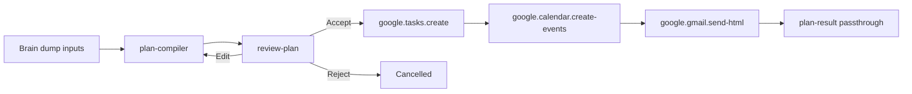

# Brain Dump to Action (`brain-dump-to-action`)

Turn a free-text brain dump into a structured action plan, review it, then optionally sync to Google Tasks, Google Calendar, and Gmail.

One planner agent compiles the plan (not five sequential LLM agents). Deterministic integrations run only after you approve.

## Workflow

| Node | Type | Key | Notes |
| --- | --- | --- | --- |
| Planner | Model agent | `plan-compiler` | Model/temp override allowed. Output = `arzly.report` v4, kind `actionPlan`. |
| Review | HumanApproval | `review-plan` | Accept / Edit / Reject. |
| Tasks | Integration | `google.tasks.create` | When `syncTasks = true`. |
| Calendar | Integration | `google.calendar.create-events` | When `syncCalendar = true`. |
| Gmail | Integration | `google.gmail.send-html` | When `sendEmail = true`. |
| Result | Passthrough agent | `plan-result` | Attaches completed result contract. |

On-demand **Run now** forces `syncTasks`, `syncCalendar`, and `sendEmail` to `false` (preview only). Scheduled runs persist the user's sync flags in `schedules.workflow_inputs_json`.

## Inputs

| Key | Required | Meaning |
| --- | --- | --- |
| `brainDump` | Yes | Raw thoughts. |
| `asOfDate` | Yes | Anchor day for the schedule. |
| `workingHoursStart` / `workingHoursEnd` | Yes | Local wall-clock, e.g. `09:00` / `17:00`. |
| `energyPreference` | No | `morning` / `afternoon` / `evening`. |
| `syncTasks` / `syncCalendar` / `sendEmail` | No | `"true"` / `"false"`; gated integrations. |
| `recipientEmail` | If email | Gmail To address. |
| `taskListTitle` | No | Default task list name (`ArzlyAI`). |
| `calendarId` | No | Default `primary`. |

## Result contract

`arzly.report` version 4, kind `actionPlan`, with blocks:

- `quickWins` — Do Now items (&lt; 15 min)
- `projects` — broken-down work with subtasks
- `schedule` — time-blocked timeline
- `priorityCallout` — Do Now / Schedule / Delegate / Defer
- `nextSteps`

The planner never generates HTML. `ArzlyReportHtmlRenderer` renders a mobile-first Action Plan page.

## Credentials

- Workflow start requires `{provider}.apiKey` for the planner (seed default: `openai.apiKey`).
- Accept after review requires Google connector credentials **only when at least one sync flag is true**.
- Preview-only runs (all sync flags false) complete on Accept without Google credentials.
- Edit sends `{provider}.apiKey` for the planner model.

Connect the relevant Google connectors in Settings (`gmail`, `google-tasks`, `google-calendar`) when sync flags are enabled. Envelope fields: `google.accessToken`, `google.email`.

## Privacy

Brain dumps are personal. SQLite stores configuration and schedule metadata only:

- Node output, approval snapshots, `finalResponse`, and rendered HTML are stripped on persist.
- Schedule failure messages are sanitized.
- In-memory `activeRunProvider` still shows the plan during the active session.

## Backend files

- `backend/src/ArzlyAI.Infrastructure/Persistence/Seeds/BrainDumpToActionPresetSeed.cs`
- `backend/src/ArzlyAI.Application/Services/Workflows/Rendering/ArzlyReportHtmlRenderer.cs`
- `backend/src/ArzlyAI.Infrastructure/Integrations/Google/GoogleTasksCreateIntegrationHandler.cs`
- `backend/src/ArzlyAI.Infrastructure/Integrations/Google/GoogleCalendarCreateEventsIntegrationHandler.cs`
- `backend/src/ArzlyAI.Infrastructure/Integrations/Google/GmailHtmlIntegrationHandler.cs`
- `backend/src/ArzlyAI.Infrastructure/Integrations/Google/ActionPlanProjection.cs`
- `backend/src/ArzlyAI.Api/Helpers/DIContainer.cs`

## Mobile files

- `mobile/arzlyai_mobile/lib/ui/features/presets/implementations/brain_dump_to_action/configure_run_screen.dart`
- `mobile/arzlyai_mobile/lib/ui/features/presets/implementations/brain_dump_to_action/execution_screen.dart`
- `mobile/arzlyai_mobile/lib/ui/features/presets/implementations/brain_dump_to_action/review_screen.dart`
- `mobile/arzlyai_mobile/lib/ui/features/presets/implementations/brain_dump_to_action/result_screen.dart`
- `mobile/arzlyai_mobile/lib/ui/features/presets/implementations/brain_dump_to_action/action_plan_report_view.dart`
- `mobile/arzlyai_mobile/lib/core/workflow/brain_dump_preset_privacy.dart`
- `mobile/arzlyai_mobile/lib/core/workflow/workflow_run_privacy.dart`
- `mobile/arzlyai_mobile/lib/ui/shared/widgets/app_brain_dump_schedule_section.dart`

## Limitations

- Planner does not read existing Calendar events or Gmail inbox.
- Time estimates are model judgment, not a timer.
- Google Tasks/Calendar use default list/`primary` unless the user typed a list title.
- OS background scheduling is best-effort.
- Users must reconnect each Google connector after adding scopes in Nango.
