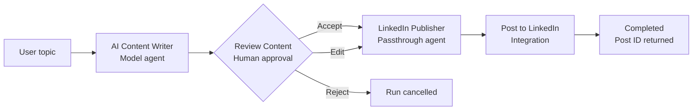
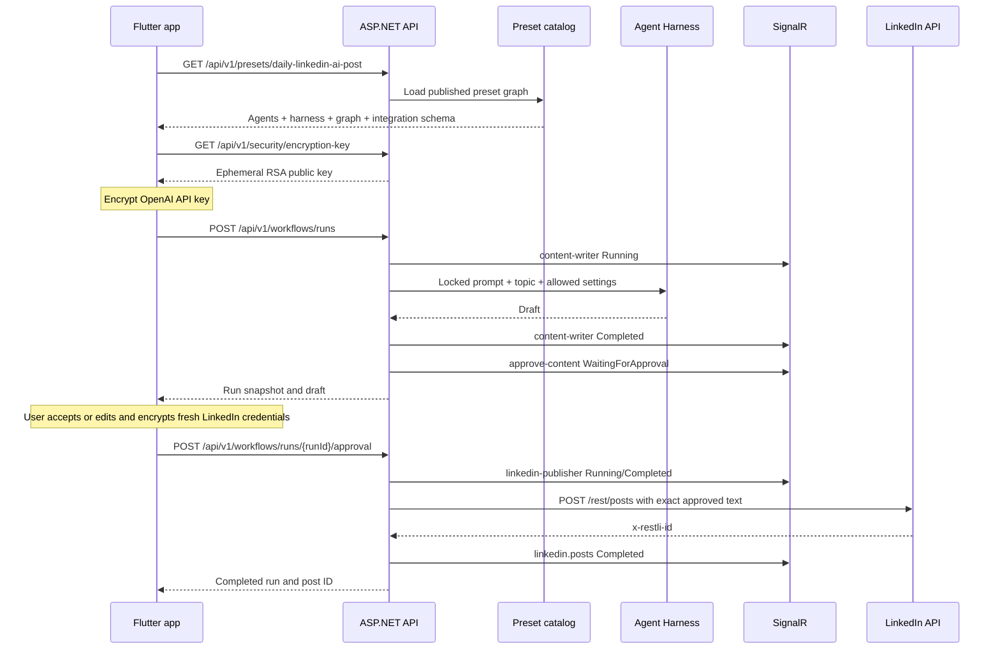
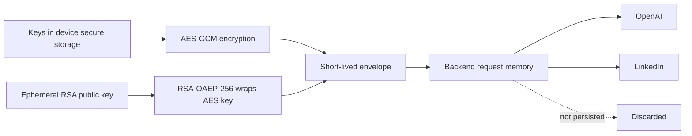

# Daily LinkedIn AI Post Preset

For the Flutter implementation sequence and client/backend contract, see
[`flutter-linkedin-client-plan.md`](flutter-linkedin-client-plan.md).

`daily-linkedin-ai-post` is the first complete ArzlyAI preset. It accepts a topic, generates a LinkedIn draft, pauses for the user to accept, edit, or reject it, and publishes only approved content.

This documents the code currently in the repository, including the Stage 1 boundaries that still require the mobile application or future production adapters.

## Definition

| Property | Value |
| --- | --- |
| Preset key | `daily-linkedin-ai-post` |
| Name | `Daily LinkedIn AI Post` |
| Version | `1` |
| Workflow key | `generate-and-publish` |
| Required input | `topic` |
| Provider | OpenAI |
| Default model | `gpt-5-mini` |
| Integration | `linkedin.posts` |
| Human approval | Required before publishing |

The complete definition is seeded by `LinkedInPresetSeed`. It checks for `daily-linkedin-ai-post` by key and returns immediately when that preset already exists.

## Flow diagram



Flutter receives four nodes and three directed connections. It should render `WorkflowGraphResponse.Nodes` and `Connections`, not hard-code this layout.

## Node 1: AI Content Writer

| Setting | Value |
| --- | --- |
| Type | `Agent` |
| Key | `content-writer` |
| Runtime | `Model` |
| Default temperature | `0.7` |
| Allowed temperature | `0.0`–`1.5` |
| Model editable | Yes, within the provider's catalog models |
| Temperature editable | Yes, within preset limits |
| System prompt editable | No |

Locked instructions:

```text
Write a concise, useful LinkedIn post. Do not invent facts. Return only the final post.
```

The prompt is returned for viewing as `AgentResponse.SystemPrompt`, but `IsSystemPromptEditable` is false. The start request contains no prompt override, and the runtime always uses the catalog-owned instructions.

Harness policy:

- Planning disabled.
- Todo tracking disabled.
- Context compaction enabled.
- Tool approval disabled.
- Maximum three iterations.
- File memory, web search, and agent skills disabled.
- OpenAI stored output disabled.

## Node 2: Review Content

This `HumanApproval` node pauses execution after draft generation. The ephemeral run preserves:

- `OriginalContent`: the AI-generated snapshot.
- `CurrentContent`: initially the draft, then the user's edit if supplied.
- `WasEdited`: calculated in the response mapper.

Available decisions:

- `Accept` continues with the original draft.
- `Edit` continues with the supplied edited content while preserving the original.
- `Reject` cancels the run without calling LinkedIn.

The node enters `WaitingForApproval`, SignalR emits `NodeChanged`, and the notification abstraction is invoked. Since credentials are not retained across the pause, accept/edit requires a fresh encrypted envelope.

## Node 3: LinkedIn Publisher

| Setting | Value |
| --- | --- |
| Type | `Agent` |
| Key | `linkedin-publisher` |
| Runtime | `Passthrough` |
| Model editable | No |
| Temperature editable | No |
| Maximum iterations | `1` |

Its locked instruction says approved content must never be rewritten. The Stage 1 runtime enforces this structurally: a `Passthrough` agent copies `CurrentContent` without making another LLM request.

## Node 4: Post to LinkedIn

The `linkedin.posts` handler receives the publisher output as `text` and requires:

```json
{
  "linkedin.accessToken": "...",
  "linkedin.authorUrn": "urn:li:person:..."
}
```

It calls LinkedIn `POST /rest/posts` with public visibility and returns the `x-restli-id` response header as `WorkflowRunResponse.FinalResponse`.

LinkedIn OAuth consent, token acquisition, refresh, and storage are not implemented yet. The client must obtain valid credentials and relay them in an encrypted envelope.

## Execution sequence



The backend creates the run ID during the start request. The app should subscribe to that run as soon as it receives the ID and use `GET /api/v1/workflows/runs/{runId}` to reconcile events it may have missed.

## API usage

### Fetch the preset

```http
GET /api/v1/presets/daily-linkedin-ai-post
```

`PresetDetailsResponse` includes both agents, editable constraints, visible locked prompts, harness settings, workflow nodes/connections, and LinkedIn's credential schema.

### Generate the draft

```http
POST /api/v1/workflows/runs
```

Conceptual request:

```json
{
  "presetKey": "daily-linkedin-ai-post",
  "inputs": {
    "topic": "Practical uses of AI agents for small businesses"
  },
  "agentOverrides": [
    {
      "agentKey": "content-writer",
      "model": "gpt-5-mini",
      "temperature": 0.7
    }
  ],
  "credentials": {
    "keyId": "server-key-id",
    "requestId": "single-use-request-id",
    "expiresAtUnixSeconds": 0,
    "wrappedKey": "base64",
    "nonce": "base64",
    "ciphertext": "base64",
    "tag": "base64"
  }
}
```

The encrypted credential JSON for this phase must contain `openai.apiKey`.

### Approve, edit, or reject

```http
POST /api/v1/workflows/runs/{runId}/approval
```

Conceptual edit request:

```json
{
  "decision": 1,
  "editedContent": "The exact user-approved post.",
  "credentials": {
    "keyId": "server-key-id",
    "requestId": "new-single-use-request-id",
    "expiresAtUnixSeconds": 0,
    "wrappedKey": "base64",
    "nonce": "base64",
    "ciphertext": "base64",
    "tag": "base64"
  }
}
```

`ApprovalDecision` currently uses the default ASP.NET JSON enum representation: `0` is Accept, `1` is Edit, and `2` is Reject. The fresh encrypted JSON must contain `linkedin.accessToken` and `linkedin.authorUrn`. Rejection stops immediately and does not require integration credentials.

## Status and realtime UI

The app subscribes to `/api/v1/hubs/workflows` using `SubscribeToRun(runId)` and handles `NodeChanged`.

| Status | Suggested client behavior |
| --- | --- |
| `Idle` | Neutral node. |
| `Running` | Animate the node; `IsRunning` is true. |
| `WaitingForApproval` | Present review controls. |
| `Completed` | Show success and relevant output. |
| `Failed` | Show error state and message. |
| `Skipped` | Dim a node skipped by a future branch. |

SignalR is transient. `WorkflowRunResponse` is the authoritative snapshot for reconnect/reconciliation during the run's 30-minute server lifetime.

## Scheduling

```http
PUT /api/v1/workflows/{workflowId}/schedule
```

Quartz creates a daily trigger using the supplied local time and host-supported time-zone ID. When due, `WorkflowDueJob` emits an `ExecutionRequested` SignalR event. It does not generate or publish independently because inputs and credentials intentionally remain on the device.

Therefore:

- Flutter must persist the activated preset, topic, and schedule in device SQLite.
- It must send a new short-lived credential envelope when execution is requested.
- In-memory Quartz schedules must be rehydrated after backend restart.
- SignalR cannot wake a closed app; that requires an FCM/APNs adapter and background handoff design.

## Security boundary



- Keys are encrypted, not hashed, because upstream services need their original values.
- Maximum envelope lifetime is 120 seconds.
- Request IDs are replay-protected and single-use.
- Credentials are absent from backend PostgreSQL and the run repository.
- Plaintext exists briefly in backend memory; saying the server never sees it would be inaccurate.

## Exact implementation files

### Definition and persistence

| File | Purpose |
| --- | --- |
| `backend/src/ArzlyAI.Infrastructure/Persistence/Seeds/LinkedInPresetSeed.cs` | Idempotently seeds the complete LinkedIn preset. |
| `backend/src/ArzlyAI.Infrastructure/Persistence/ArzlyDbContext.cs` | Applies migrations and invokes registered preset seeds through `InitializeAsync`. |
| `backend/src/ArzlyAI.Infrastructure/Persistence/ArzlyDbContext.cs` | EF Core catalog configuration. |
| `backend/src/ArzlyAI.Infrastructure/Persistence/Migrations/20260828135456_InitialPostgreSqlCatalog.cs` | Initial PostgreSQL catalog schema, including audit timestamps. |
| `backend/src/ArzlyAI.Infrastructure/Persistence/Interceptors/AuditTimestampInterceptor.cs` | Sets UTC timestamps before synchronous or asynchronous saves. |
| `backend/src/ArzlyAI.Application/Repositories/IGenericRepository.cs` | Generic cancellable CRUD contract for audited GUID entities. |
| `backend/src/ArzlyAI.Infrastructure/Persistence/Repositories/GenericRepository.cs` | EF Core implementation inherited by feature repositories. |
| `backend/src/ArzlyAI.Application/Repositories/Presets/IPresetRepository.cs` | Preset repository contract. |
| `backend/src/ArzlyAI.Infrastructure/Persistence/Repositories/Presets/PresetRepository.cs` | Loads published preset graphs. |

### Domain model

| File | Purpose |
| --- | --- |
| `backend/src/ArzlyAI.Domain/Entities/Presets/PresetDefinition.cs` | Preset aggregate. |
| `backend/src/ArzlyAI.Domain/Entities/Common/Base.cs` | Shared GUID identity and UTC audit timestamps; no soft delete. |
| `backend/src/ArzlyAI.Domain/Entities/Presets/AgentDefinition.cs` | Agent prompt, runtime, model, and override policy. |
| `backend/src/ArzlyAI.Domain/Entities/Presets/AgentHarnessDefinition.cs` | Harness policy. |
| `backend/src/ArzlyAI.Domain/Entities/Presets/WorkflowDefinition.cs` | Graph container. |
| `backend/src/ArzlyAI.Domain/Entities/Presets/WorkflowStepDefinition.cs` | Workflow node and mapping metadata. |
| `backend/src/ArzlyAI.Domain/Entities/Presets/WorkflowConnectionDefinition.cs` | Directed graph edge. |
| `backend/src/ArzlyAI.Domain/Entities/Presets/PresetIntegration.cs` | Preset/integration association. |
| `backend/src/ArzlyAI.Domain/Entities/Integrations/IntegrationDefinition.cs` | LinkedIn metadata and credential schema. |
| `backend/src/ArzlyAI.Domain/Entities/Providers/ProviderDefinition.cs` | Provider catalog entry. |
| `backend/src/ArzlyAI.Domain/Entities/Providers/ModelDefinition.cs` | Allowed model entry. |
| `backend/src/ArzlyAI.Domain/Enums/AgentRuntimeType.cs` | Model versus passthrough execution. |
| `backend/src/ArzlyAI.Domain/Enums/ApprovalDecision.cs` | Accept, Edit, and Reject values. |
| `backend/src/ArzlyAI.Domain/Enums/WorkflowNodeType.cs` | Agent, HumanApproval, and Integration node types. |
| `backend/src/ArzlyAI.Domain/Enums/WorkflowNodeStatus.cs` | Per-node runtime states. |
| `backend/src/ArzlyAI.Domain/Enums/WorkflowRunStatus.cs` | Overall run states. |

### Preset transport

| File | Purpose |
| --- | --- |
| `backend/src/ArzlyAI.Api/Controllers/v1/PresetsController.cs` | Version 1 list/detail endpoints. |
| `backend/src/ArzlyAI.Application/Services/Presets/IPresetService.cs` | Preset use-case contract. |
| `backend/src/ArzlyAI.Application/Services/Presets/PresetService.cs` | Retrieves published presets. |
| `backend/src/ArzlyAI.Application/Mappers/Presets/IPresetMapper.cs` | Mapping contract. |
| `backend/src/ArzlyAI.Application/Mappers/Presets/PresetMapper.cs` | Maps the complete graph to response DTOs. |
| `backend/src/ArzlyAI.Application/DTOs/Presets/PresetSummaryResponse.cs` | Preset catalog-card response. |
| `backend/src/ArzlyAI.Application/DTOs/Presets/PresetDetailsResponse.cs` | Complete selected-preset response. |
| `backend/src/ArzlyAI.Application/DTOs/Presets/AgentResponse.cs` | Agent UI definition and locked-prompt flag. |
| `backend/src/ArzlyAI.Application/DTOs/Presets/AgentModelConfigurationResponse.cs` | Selected model, allowed models, and temperature constraints. |
| `backend/src/ArzlyAI.Application/DTOs/Presets/ModelOptionResponse.cs` | One selectable model. |
| `backend/src/ArzlyAI.Application/DTOs/Presets/AgentHarnessResponse.cs` | Harness settings shown to the client. |
| `backend/src/ArzlyAI.Application/DTOs/Presets/WorkflowGraphResponse.cs` | Nodes and directed connections. |
| `backend/src/ArzlyAI.Application/DTOs/Presets/WorkflowNodeResponse.cs` | One canvas node. |
| `backend/src/ArzlyAI.Application/DTOs/Presets/WorkflowConnectionResponse.cs` | One canvas edge. |
| `backend/src/ArzlyAI.Application/DTOs/Presets/IntegrationRequirementResponse.cs` | LinkedIn requirement and credential-schema response. |

### Execution and state

| File | Purpose |
| --- | --- |
| `backend/src/ArzlyAI.Api/Controllers/v1/WorkflowsController.cs` | Version 1 run, approval, and schedule endpoints. |
| `backend/src/ArzlyAI.Application/Services/Workflows/IWorkflowExecutionService.cs` | Execution use-case contract. |
| `backend/src/ArzlyAI.Application/Services/Workflows/WorkflowExecutionService.cs` | Draft, approval, passthrough, and integration orchestration. |
| `backend/src/ArzlyAI.Application/Models/WorkflowRun.cs` | Ephemeral run and content snapshots. |
| `backend/src/ArzlyAI.Application/Models/WorkflowNodeRun.cs` | Per-node runtime state. |
| `backend/src/ArzlyAI.Application/Repositories/Workflows/IWorkflowRunRepository.cs` | Run storage contract. |
| `backend/src/ArzlyAI.Infrastructure/Persistence/Repositories/Workflows/InMemoryWorkflowRunRepository.cs` | 30-minute in-memory storage. |
| `backend/src/ArzlyAI.Application/Mappers/Workflows/IWorkflowRunMapper.cs` | Run mapping contract. |
| `backend/src/ArzlyAI.Application/Mappers/Workflows/WorkflowRunMapper.cs` | Maps run state to response snapshots. |
| `backend/src/ArzlyAI.Application/DTOs/Workflows/AgentOverrideRequest.cs` | Allowed model and temperature overrides. |
| `backend/src/ArzlyAI.Application/DTOs/Workflows/StartWorkflowRequest.cs` | Start command containing preset key, inputs, overrides, and envelope. |
| `backend/src/ArzlyAI.Application/DTOs/Workflows/SubmitApprovalRequest.cs` | Accept/edit/reject command and fresh envelope. |
| `backend/src/ArzlyAI.Application/DTOs/Workflows/ScheduleWorkflowRequest.cs` | Daily local time and time-zone command. |
| `backend/src/ArzlyAI.Application/DTOs/Workflows/WorkflowRunResponse.cs` | Full run snapshot returned to Flutter. |
| `backend/src/ArzlyAI.Application/DTOs/Workflows/WorkflowNodeRunResponse.cs` | One node's status, output, and error. |
| `backend/src/ArzlyAI.Application/DTOs/Workflows/ApprovalSnapshotResponse.cs` | Original/current content and edit flag. |
| `backend/src/ArzlyAI.Application/DTOs/Workflows/WorkflowNodeChangedEvent.cs` | SignalR node-status event. |

### Agent and integration

| File | Purpose |
| --- | --- |
| `backend/src/ArzlyAI.Application/Services/Agents/IAgentRuntime.cs` | Provider-independent agent contract. |
| `backend/src/ArzlyAI.Infrastructure/Agents/OpenAiAgentRuntime.cs` | OpenAI Responses and Agent Framework/Harness adapter. |
| `backend/src/ArzlyAI.Application/Integrations/IIntegrationHandler.cs` | Generic integration contract. |
| `backend/src/ArzlyAI.Application/Abstractions/ILinkedInPublisher.cs` | LinkedIn publishing port. |
| `backend/src/ArzlyAI.Infrastructure/Integrations/LinkedIn/LinkedInPostsIntegrationHandler.cs` | Maps workflow data to LinkedIn inputs. |
| `backend/src/ArzlyAI.Infrastructure/Integrations/LinkedIn/LinkedInPublisher.cs` | Calls LinkedIn REST Posts API. |

### Security, realtime, scheduling, and notifications

| File | Purpose |
| --- | --- |
| `backend/src/ArzlyAI.Api/Controllers/v1/SecurityController.cs` | Version 1 public-key endpoint. |
| `backend/src/ArzlyAI.Application/Security/CredentialEnvelope.cs` | Envelope contract. |
| `backend/src/ArzlyAI.Application/Security/EncryptionKeyDescriptor.cs` | Public-key response. |
| `backend/src/ArzlyAI.Application/Security/ICredentialEnvelopeProtector.cs` | Protection contract. |
| `backend/src/ArzlyAI.Infrastructure/Security/EphemeralCredentialEnvelopeProtector.cs` | Decryption, expiry, and replay protection. |
| `backend/src/ArzlyAI.Api/Hubs/WorkflowHub.cs` | SignalR subscriptions. |
| `backend/src/ArzlyAI.Api/Hubs/IWorkflowClient.cs` | Typed SignalR client contract. |
| `backend/src/ArzlyAI.Application/Services/Realtime/IWorkflowRealtimeNotifier.cs` | Realtime abstraction. |
| `backend/src/ArzlyAI.Api/Realtime/SignalRWorkflowRealtimeNotifier.cs` | SignalR notifier. |
| `backend/src/ArzlyAI.Application/Abstractions/IWorkflowScheduler.cs` | Scheduler contract. |
| `backend/src/ArzlyAI.Infrastructure/Scheduling/DailyWorkflowScheduler.cs` | Quartz daily scheduler. |
| `backend/src/ArzlyAI.Infrastructure/Scheduling/WorkflowDueJob.cs` | Due-event job. |
| `backend/src/ArzlyAI.Application/Services/Notifications/INotificationService.cs` | Notification contract. |
| `backend/src/ArzlyAI.Infrastructure/Notifications/LoggingNotificationService.cs` | Logging-only Stage 1 adapter. |
| `backend/src/ArzlyAI.Api/Program.cs` | Application startup and HTTP pipeline. |
| `backend/src/ArzlyAI.Api/Helpers/DIContainer.cs` | API and Infrastructure registrations. |
| `backend/tests/ArzlyAI.Tests/PresetServiceTests.cs` | Preset mapping/constraint test. |

## Stage 1 limitations

- Execution currently supports the seeded linear flow; it is not yet a generic branching/parallel DAG engine.
- Runs and schedules are memory-backed.
- Notifications are logged instead of sent through FCM/APNs.
- LinkedIn OAuth and refresh are outside the backend.
- The seed prevents duplicate preset keys, but production preset upgrades still need an explicit version/update strategy.
