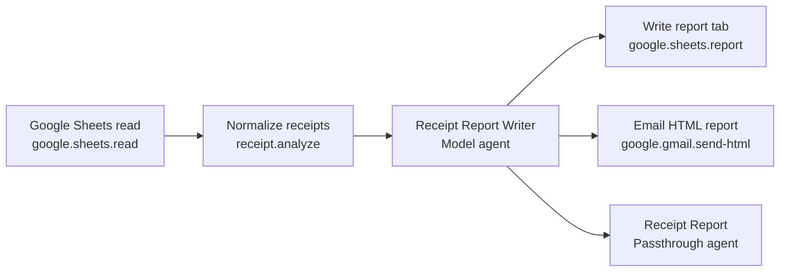

# Receipt automation

Seven receipt presets share one backend engine, one Flutter configurator, and one privacy policy. Google Sheets is the source of truth for receipt rows; the app orchestrates reads, deterministic analysis, optional AI narrative, and delivery without persisting receipt data or generated reports locally.

Google OAuth brokerage: [`../connectors/nango-google.md`](../connectors/nango-google.md).

All presets use workflow key `analyze-and-deliver`, seed version `1`, and result contract `arzly.report` v4 with `kind: financeReport`.

## Presets

| Preset key | Name | Analysis mode | Extra inputs | Deterministic output |
| --- | --- | --- | --- | --- |
| `receipt-monthly-spending` | Monthly Receipt Spending | `monthly-spending` | — | Month-to-date totals, category and merchant breakdowns |
| `receipt-weekly-budget` | Weekly Receipt Budget | `weekly-budget` | `budget` | Spent vs weekly budget, remaining amount |
| `receipt-quarterly-tax` | Quarterly Receipt Tax | `quarterly-tax` | `taxRate` (0–1) | Quarter totals and `estimatedTax` (arithmetic only, not tax advice) |
| `receipt-yearly-review` | Yearly Receipt Review | `yearly-review` | — | Year-to-date totals and `monthlyTotals` trends |
| `receipt-category-dive` | Receipt Category Dive | `category-dive` | `category` | Filtered breakdown for one category (case-insensitive) |
| `receipt-anomaly-detector` | Receipt Anomaly Detector | `anomaly-detector` | — | `anomalies` collection for unusual amounts |
| `receipt-savings-tracker` | Receipt Savings Tracker | `savings-tracker` | `budget` | Spending vs monthly target, `potentialSavings` |

### Typical use by preset

- **Monthly spending** — on-demand preview near month end, or scheduled monthly delivery to Sheets/Gmail.
- **Weekly budget** — scheduled weekly with a fixed budget cap.
- **Quarterly tax** — scheduled on the first day of each quarter for accountant-ready summaries.
- **Yearly review** — scheduled in January or on-demand before annual planning.
- **Category dive** — investigate one spending area (Food, Travel, etc.) on-demand or on a fixed schedule.
- **Anomaly detector** — scheduled weekly/monthly to flag unexpected large purchases.
- **Savings tracker** — scheduled mid-month and month-end against a monthly spending target.

## Workflow

Steps 4 and 5 are conditional on `deliveryMode`:

| `deliveryMode` | Sheets write | Gmail send |
| --- | ---: | ---: |
| `preview` | Skipped | Skipped |
| `sheets` | Runs | Skipped |
| `email` | Skipped | Runs |
| `both` | Runs | Runs |

On-demand runs from the mobile configurator always send `deliveryMode: preview`. Scheduled runs override stored inputs with `deliveryMode: deliver` at execution time — **this value is not recognized by the backend gate today**; scheduled delivery requires mapping to `sheets`, `email`, or `both` before the integration steps run. See [Known gaps](#known-gaps).

There is no human-approval node. The run completes when the passthrough agent returns the structured report.

## Inputs (shared)

| Key | Required | Meaning |
| --- | --- | --- |
| `spreadsheetId` | Yes | Google spreadsheet id from the connected account. |
| `sourceRange` | Yes | A1 notation range including tab, e.g. `'Receipts'!A:Z`. |
| `columnMappingJson` | Yes | JSON object mapping logical fields to header names: `date`, `amount`, `category`, `merchant`. |
| `asOfDate` | Yes | ISO date anchoring the reporting period. |
| `currencyCode` | Yes | ISO 4217 code for display. |
| `budget` | Mode-dependent | Weekly or savings budget amount. |
| `taxRate` | Mode-dependent | Decimal rate between 0 and 1 for quarterly tax estimate. |
| `category` | Mode-dependent | Category filter for category dive. |
| `deliveryMode` | No | `preview`, `sheets`, `email`, or `both`. |
| `reportTabTitle` | No | Destination tab for Sheets delivery (default `Receipt Report`). |
| `recipientEmail` | No | Gmail recipient when emailing reports. |

Receipt rows must include a header row plus up to **1000** data rows. Malformed dates, amounts, or missing mapped columns reject the entire input.

## Deterministic analysis

`ReceiptAnalysisOperation` (`receipt.analyze`) parses sheet rows, filters to the mode-specific period, and emits JSON aggregates (totals, category and merchant breakdowns, mode-specific metrics such as budget remaining, tax estimate, anomalies, or savings). The LLM receives only this summary — never raw receipt rows.

## AI narrative

| Agent | Key | Overrides | Harness |
| --- | --- | --- | --- |
| Receipt Report Writer | `receipt-report-writer` | Model and temperature | Compaction on, max 3 iterations, no web search |
| Receipt Report | `receipt-report-result` | None (passthrough) | Max 1 iteration |

The writer must return `arzly.report` v4 with `kind: financeReport` and blocks such as `financeSummary`, `categoryBreakdown`, `merchantBreakdown`, `budgetStatus`, `anomalyCallout`, `taxEstimate`, `trend`, and `nextSteps`. `ArzlyReportHtmlRenderer` renders finance reports for in-session preview.

## Credentials

Workflow start requires:

- `{provider}.apiKey` for the selected report-writer model (default OpenAI `gpt-5-mini`).
- `google.accessToken` and optionally `google.email` from the Nango Google connector.

Provider API keys live in platform secure storage. Google OAuth tokens sync from Nango into secure storage and `connector_credentials` for envelope assembly. The backend never stores OAuth tokens in PostgreSQL.

## Privacy (mobile)

Receipt presets enforce **zero receipt/report persistence** in SQLite:

- `WorkflowRepository._persistableRun` strips node output/errors, approval snapshots, `finalResponse`, parsed reports, and rendered HTML before writing `workflow_runs`.
- Node rows are deleted and re-inserted without output for receipt presets.
- Schedule failure messages and API errors are sanitized to generic copy.
- In-memory `activeRunProvider` still holds full run state during an active session so the result screen can render once.

SQLite retains only operational metadata: preset key, spreadsheet id, column mapping, schedule recurrence, model overrides, and connector field keys — not receipt row values or report content.

## On-demand vs scheduled

| Mode | `deliveryMode` | User experience |
| --- | --- | --- |
| On-demand (Configure run → Run now) | `preview` | Full HTML report in the result screen; no Sheets/Gmail side effects. |
| Scheduled (background executor) | Intended `sheets` / `email` / `both` from saved preferences; currently sends `deliver` | Should write to Sheets and/or Gmail automatically; see known gap. |

Scheduling uses the shared `AppScheduleSection` with recurrence types (daily, weekly, monthly, quarterly, yearly, custom). Receipt schedules store sheet selection, mapping, currency, mode-specific fields, recipient email, and report tab title in `schedules.workflow_inputs_json`.

## Backend files

| File | Purpose |
| --- | --- |
| `backend/src/ArzlyAI.Infrastructure/Persistence/Seeds/ReceiptPresetSeed.cs` | Seven idempotent preset seeds |
| `backend/src/ArzlyAI.Application/Services/Workflows/Operations/ReceiptAnalysisOperation.cs` | Deterministic receipt engine |
| `backend/src/ArzlyAI.Infrastructure/Integrations/Google/GoogleSheetsReadIntegrationHandler.cs` | Sheet read integration |
| `backend/src/ArzlyAI.Infrastructure/Integrations/Google/GoogleSheetsReportIntegrationHandler.cs` | Report tab write |
| `backend/src/ArzlyAI.Infrastructure/Integrations/Google/GmailHtmlIntegrationHandler.cs` | HTML email delivery |
| `backend/src/ArzlyAI.Infrastructure/Integrations/Google/FinanceReportProjection.cs` | Report → rows/HTML for delivery |
| `backend/src/ArzlyAI.Infrastructure/Integrations/Google/GoogleSheetsClient.cs` | Drive/Sheets API adapter |
| `backend/src/ArzlyAI.Infrastructure/Integrations/Google/GmailClient.cs` | Gmail send adapter |
| `backend/src/ArzlyAI.Application/Services/Connectors/GoogleResourceService.cs` | Spreadsheet metadata for mobile |
| `backend/src/ArzlyAI.Api/Controllers/v1/ConnectorsController.cs` | Google resource HTTP endpoints |
| `backend/src/ArzlyAI.Application/Services/Workflows/Rendering/ArzlyReportHtmlRenderer.cs` | Finance HTML rendering |
| `backend/tests/ArzlyAI.Tests/ReceiptBackendTests.cs` | Operation, seed, delivery gate, render tests |
| `backend/tests/ArzlyAI.Tests/GoogleIntegrationTests.cs` | Sheets/Gmail handler tests |

## Mobile files

| File | Purpose |
| --- | --- |
| `mobile/arzlyai_mobile/lib/ui/features/presets/implementations/receipt_workflows/configure_run_screen.dart` | Shared configurator for all seven presets |
| `mobile/arzlyai_mobile/lib/ui/features/presets/implementations/receipt_workflows/execution_screen.dart` | Node progress |
| `mobile/arzlyai_mobile/lib/ui/features/presets/implementations/receipt_workflows/result_screen.dart` | In-session report preview |
| `mobile/arzlyai_mobile/lib/ui/features/presets/implementations/receipt_workflows/receipt_report_view.dart` | Finance report WebView |
| `mobile/arzlyai_mobile/lib/ui/features/presets/implementations/receipt_workflows/receipt_workflow_metadata.dart` | Preset metadata and mapping helpers |
| `mobile/arzlyai_mobile/lib/core/workflow/receipt_preset_privacy.dart` | Preset key set and error sanitization |
| `mobile/arzlyai_mobile/lib/ui/shared/widgets/app_google_sheet_selector.dart` | Spreadsheet/tab/header picker |
| `mobile/arzlyai_mobile/lib/ui/features/settings/settings_google_connector_screen.dart` | Google connector settings |
| `mobile/arzlyai_mobile/lib/data/repositories/connectors/google_resource_repository.dart` | Spreadsheet metadata repository |
| `mobile/arzlyai_mobile/lib/ui/shared/widgets/app_schedule_section.dart` | Schedule + receipt input persistence |
| `mobile/arzlyai_mobile/lib/data/services/scheduling/scheduled_workflow_executor.dart` | Background run orchestration |
| `mobile/arzlyai_mobile/lib/data/repositories/workflow/workflow_repository.dart` | Privacy stripping on persist |
| `mobile/arzlyai_mobile/test/repositories/receipt_workflow_privacy_test.dart` | Privacy enforcement tests |
| `mobile/arzlyai_mobile/test/presets/receipt_workflows/` | Config and fixture tests |

## Known gaps

- **Scheduled `deliveryMode: deliver`**: Mobile scheduling sends `deliver`, but backend integration gates only accept `sheets`, `email`, or `both`. Scheduled Sheets/Gmail delivery is skipped until mobile maps saved preferences to a recognized mode (or backend adds a `deliver` alias).
- **On-demand delivery UI**: The configurator saves recipient and tab preferences for schedules but forces preview on manual runs; delivery controls are labeled for a future release.
- **No human review gate**: Unlike LinkedIn or Smart Buy, receipt runs do not pause for approval before delivery when delivery modes are enabled.
- **Codegen**: Flutter Riverpod/Drift generated files (`*.g.dart`) may be stale until the developer runs `fvm dart run build_runner build --delete-conflicting-outputs`.
- **Drift schema v5**: After pulling receipt/scheduling changes, uninstall the app or clear app data so `onCreate` runs with the new schema. There is no `onUpgrade` path during active development.

## Limitations

- Sequential execution only; no human approval before delivery.
- Receipt reads capped at 1000 rows per run.
- Quarterly tax output is a simple rate multiplication, not professional tax advice.
- Anomaly detection uses deterministic statistics; false positives/negatives are possible on small datasets.
- Scheduled background delivery depends on OS scheduling guarantees and the `deliveryMode` mapping gap above.
