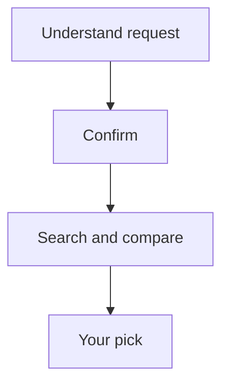

# Smart Buy (`smart-purchase-decision`)

Smart Buy helps everyday shoppers pick a product. Describe what you want, confirm the app understood you, then get a local shortlist with in-country store links and one clear winner.

It supports electronics, appliances, furniture, tools, and similar goods. It does not cover medical or financial products, insurance, real estate, vehicles, or professional procurement.

## Workflow



The first approval prevents expensive web search on a misunderstood request. Accept continues with a fresh credential envelope for the selected AI provider; Edit sends feedback back to the understand agent; Reject cancels. The final approval lets the user keep the recommendation or try a different search. Final Accept requires no credentials because no nodes remain.

## Inputs

| Key | Required | Meaning |
| --- | --- | --- |
| `purchaseGoal` | Yes | What you want to buy and why. |
| `budget` | No | Maximum budget amount. |
| `notes` | No | Pets, quiet operation, brands you already like, etc. |
| `countryCode` | Yes | ISO market code for availability. |
| `currencyCode` | Yes | Currency for prices (auto-filled from country on mobile). |

## Agents

| Agent | Responsibility | Web search | Max iterations |
| --- | --- | ---: | ---: |
| `understand-request` | Restates the ask in plain language with a short checklist. | No | 3 |
| `shop-and-recommend` | Searches the web for local retailers, returns at least three sourced suggestions when available, and outputs `arzly.report` v4. | Yes | 8 |

Only `shop-and-recommend` allows model and temperature overrides on the client.

DeepSeek, Anthropic, and Gemini web-search models use up to three provider-native hosted-search passes. Each pass receives the findings from earlier passes and is instructed to use different queries and sources to close product, pricing, availability, URL, image, and specification gaps. The pass count is bounded by the agent's `MaxIterations`; the final structured-output pass receives all accumulated evidence. OpenAI uses its Harness-managed iterative search.

## Result contract

Final approval and completed runs include `FinalResponse`, a parsed `ResultDocument`, and safe backend-rendered HTML. Smart Buy uses `arzly.report` version 4:

```json
{
  "schema": "arzly.report",
  "version": 4,
  "kind": "purchaseDecision",
  "title": "Best laptop for university",
  "summary": "...",
  "generatedAtUtc": "...",
  "blocks": [
    { "type": "recommendation", "title": "Our pick", "data": {} },
    { "type": "candidateComparison", "title": "Also consider", "data": {} },
    { "type": "riskCallout", "title": "Before you buy", "data": {} }
  ],
  "sources": []
}
```

Supported blocks are `recommendation`, `candidateComparison`, `riskCallout`, and `nextSteps`. The model never generates HTML; `ArzlyReportHtmlRenderer` creates a mobile-first shopper page.

## Credentials

- Workflow start requires `openai.apiKey` (seed default) plus any `{provider}.apiKey` used in a model override.
- `shop-and-recommend` requires a model marked as supporting hosted web search by the backend capability policy.
- Configure keys in Settings (`GET /api/v1/providers`); default model is stored in SQLite and seeds preset pickers.
- Start and first-gate Accept/Edit need a fresh envelope.
- Final Accept needs no credentials.

## Backend files

- `backend/src/ArzlyAI.Infrastructure/Persistence/Seeds/SmartPurchaseDecisionPresetSeed.cs`
- `backend/src/ArzlyAI.Application/Services/Workflows/Rendering/ArzlyReportHtmlRenderer.cs`
- `backend/src/ArzlyAI.Infrastructure/Agents/OpenAiAgentRuntime.cs` (Harness web search)
- `backend/src/ArzlyAI.Infrastructure/Agents/DeepSeekAgentRuntime.cs` (bounded native hosted-search passes)
- `backend/src/ArzlyAI.Infrastructure/Agents/AnthropicAgentRuntime.cs` (bounded native hosted-search passes)
- `backend/src/ArzlyAI.Infrastructure/Agents/GeminiAgentRuntime.cs` (bounded native hosted-search passes)
- `backend/src/ArzlyAI.Api/Controllers/v1/ProviderModelsController.cs`

## Mobile files

- `mobile/arzlyai_mobile/lib/ui/features/presets/implementations/smart_purchase_decision/configure_run_screen.dart`
- `mobile/arzlyai_mobile/lib/ui/features/presets/implementations/smart_purchase_decision/execution_screen.dart`
- `mobile/arzlyai_mobile/lib/ui/features/presets/implementations/smart_purchase_decision/review_screen.dart`
- `mobile/arzlyai_mobile/lib/ui/features/presets/implementations/smart_purchase_decision/result_screen.dart`
- `mobile/arzlyai_mobile/lib/ui/features/presets/implementations/smart_purchase_decision/smart_purchase_brief_panel.dart`

## Limitations

- Sequential execution only; Edit on the final gate re-runs search, not the understand step.
- Prices and availability are point-in-time research observations from web search.
- Repeated provider-native searches can try alternative indexed sources, but retailer anti-bot responses and inaccessible pages can still leave prices, availability, direct links, or images unverified.
- Store links must be verified HTTPS product pages from in-country retailers; global catalog pages may appear when local listings are thin.
- Product images require verified direct HTTPS image URLs; hotlink blocking on retailer CDNs can still hide images in the WebView.
- The workflow never invents stores, prices, images, or links.
