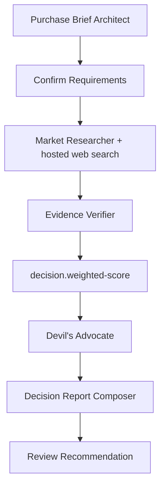

# Smart Buy Lab (`smart-purchase-decision`)

Smart Buy Lab researches and compares ordinary consumer products against a user-specific decision model. It supports electronics, appliances, furniture, tools, and similar goods. It does not cover medical or financial products, insurance, real estate, vehicles, or professional procurement.

## Workflow



The first approval prevents expensive research against misunderstood requirements. Accept continues with a fresh OpenAI credential envelope; Edit sends feedback back to the brief architect; Reject cancels. The final approval lets the user save, revise the explanation, or discard the report. Final Accept requires no credentials because no nodes remain.

## Inputs

The preset exposes a versioned input schema through `PresetDetailsResponse.InputSchemaJson`, allowing Flutter to build the form without hard-coding its fields.

| Key | Required | Meaning |
| --- | --- | --- |
| `purchaseGoal` | Yes | Product category, use, and desired outcome. |
| `countryCode` | Yes | ISO market code used for availability. |
| `currencyCode` | Yes | Currency used for prices and ownership cost. |
| `budgetMin` / `budgetMax` | No | Non-negative budget boundaries. |
| `priorities` | No | Qualities that should receive more weight. |
| `constraints` | No | Deal-breakers and mandatory requirements. |
| `candidateSeeds` | No | JSON list of up to five names or HTTPS URLs. |

The researcher uses hybrid discovery: supplied candidates are considered and missing alternatives may be discovered, with two to five candidates in the final comparison.

## Agents and Harness policies

| Agent | Responsibility | Web search | Max iterations |
| --- | --- | ---: | ---: |
| `purchase-brief-architect` | Creates measurable weighted criteria. | No | 4 |
| `market-researcher` | Discovers current products, prices, claims, and sources. | Yes | 8 |
| `evidence-verifier` | Resolves variants/conflicts and produces evidence-grounded criterion scores. | No | 5 |
| `devils-advocate` | Challenges the winner without changing arithmetic. | No | 3 |
| `report-composer` | Produces the final versioned report document. | No | 4 |

Every agent uses a stored JSON schema through Agent Framework structured output. The Harness enables provider-hosted web search only for the researcher. Search pages are untrusted data: their instructions must be ignored, secrets must never enter search queries, and unsupported facts remain missing rather than being invented.

## Deterministic scoring

`decision.weighted-score` is an internal workflow `Operation`, not an LLM or external integration. A failed mandatory criterion disqualifies a candidate. Otherwise:

```text
fitScore = sum(criterionScore × criterionWeight) / sum(criterionWeight)
```

Scores are rounded to two decimals. Evidence confidence is reported separately. Equal fit scores are ordered by lower total ownership cost, then higher confidence. The agent explains the result but cannot alter calculated scores.

## Result contract

Final-approval and completed run snapshots include `FinalResponse`, a parsed `ResultDocument`, and safe backend-rendered HTML. Smart Buy uses `arzly.report` version 3:

```json
{
  "schema": "arzly.report",
  "version": 3,
  "kind": "purchaseDecision",
  "title": "Best laptop for university",
  "summary": "...",
  "generatedAtUtc": "...",
  "blocks": [
    { "type": "recommendation", "title": "Best match", "data": {} }
  ],
  "sources": []
}
```

Supported blocks are `recommendation`, `candidateComparison`, `scoreBreakdown`, `prosCons`, `riskCallout`, `rejectedCandidates`, and `nextSteps`. Report items carry an optional verified HTTPS `imageUrl` plus up to three store actions containing `storeName`, price/action `label`, availability, and a direct HTTPS product URL. The model never generates HTML: `ArzlyReportHtmlRenderer` creates a concise mobile-first decision page with one winner, a compact shortlist, collapsible scoring/rejections/sources, accessible offer buttons, and no duplicated source block. Flutter uses a locked-down WebView and keeps its native renderer as a fallback.

## Credentials and data ownership

- Only `openai.apiKey` is required.
- The key remains in platform secure storage and each request uses a new short-lived envelope.
- Research packets, preferences, run snapshots, reports, and scenario adjustments remain in device SQLite.
- PostgreSQL contains only the public preset graph, prompts, policies, and schemas.
- Prices and availability are timestamped observations, not guarantees.

## Exact implementation files

For the mobile implementation, see [Flutter Smart Purchase HTML report handoff](flutter-smart-purchase-html-report.md).

### Backend

- `backend/src/ArzlyAI.Infrastructure/Persistence/Seeds/SmartPurchaseDecisionPresetSeed.cs`
- `backend/src/ArzlyAI.Application/Services/Workflows/Operations/WeightedDecisionScoringOperation.cs`
- `backend/src/ArzlyAI.Application/Services/Workflows/Execution/OperationWorkflowNodeHandler.cs`
- `backend/src/ArzlyAI.Infrastructure/Agents/OpenAiAgentRuntime.cs`
- `backend/src/ArzlyAI.Application/Mappers/Presets/PresetMapper.cs`
- `backend/src/ArzlyAI.Application/Mappers/Workflows/WorkflowRunMapper.cs`
- `backend/src/ArzlyAI.Application/Services/Workflows/Rendering/ArzlyReportHtmlRenderer.cs`
- `backend/src/ArzlyAI.Infrastructure/Persistence/Migrations/20260829164310_SmartBuyLabCatalog.cs`

### Flutter

- `mobile/arzlyai_mobile/lib/ui/features/presets/configure/dynamic_preset_configure_screen.dart`
- `mobile/arzlyai_mobile/lib/ui/features/presets/implementations/smart_purchase_decision/review_screen.dart`
- `mobile/arzlyai_mobile/lib/ui/features/presets/implementations/smart_purchase_decision/result_screen.dart`
- `mobile/arzlyai_mobile/lib/data/services/reports/report_export_service.dart`
- `mobile/arzlyai_mobile/lib/ui/features/presets/preset_run_router.dart`

## Limitations

- The execution engine remains sequential; the Devil's Advocate reports evidence gaps but does not conditionally branch back to research.
- A request for deeper research starts a new run. Final Edit revises the report explanation only.
- Candidate scores depend on the evidence available at execution time.
- Price tracking, affiliate purchases, retailer OAuth, checkout, and scheduled re-research are out of scope.
- Product images are optional and require reliable HTTPS URLs; the workflow never invents them.
- Store offers are point-in-time research observations, limited to three verified direct links per product.
