# Add a preset flow (mobile)

How presets work in `arzlyai_mobile`, and how to add a new one after the backend/admin publishes it.

## Mental model

| Layer | Owned by | Mobile responsibility |
| --- | --- | --- |
| Preset catalog & graph | Backend / admin | Fetch, cache, display (generic) |
| Workflow execution | Backend | Start run, approval, SignalR (generic) |
| Run UI (configure → execute → review → result) | Mobile per preset | One implementation folder per preset |
| Credentials | User + Settings | Schema-driven from API (generic storage) |

The app does **not** hard-code preset names in generic code. Catalog and details screens read `PresetDetailsResponse`. Only the **run journey** (screens after “Configure run”) is implemented per preset under `implementations/<preset_key>/`.

**Reference implementations:**

- `daily-linkedin-ai-post` → `implementations/daily_linkedin_ai_post/` (human approval + publish)
- `smart-purchase-decision` → `implementations/smart_purchase_decision/` (two approval gates)
- `receipt-*` (seven presets) → `implementations/receipt_workflows/` (shared configurator, no approval gate, zero report persistence)

Monorepo backend contract: `docs/presets/` (e.g. `linkedin-preset.md`, [`receipt-automation.md`](../../docs/presets/receipt-automation.md)).

---

## Folder map

```
doc/add_preset_flow.md                    # preset UI / run journey
doc/sqlite_schema.md                      # local DB tables and relationships

lib/ui/features/presets/
  catalog/preset_catalog_screen.dart      # lists all presets from API
  details/preset_details_screen.dart      # workflow graph, integrations, Configure run
  preset_run_router.dart                  # maps preset key → first run screen
  implementations/
    daily_linkedin_ai_post/               # LinkedIn MVP only
      preset_key.dart                     # const key = 'daily-linkedin-ai-post'
      configure_run_screen.dart
      execution_screen.dart
      review_screen.dart
      result_screen.dart
    smart_purchase_decision/              # Smart Buy Lab run journey
      preset_key.dart
      review_screen.dart
      result_screen.dart
      execution_screen.dart               # test-only hub pattern
    receipt_workflows/                    # Shared run journey for all receipt-* presets
      configure_run_screen.dart
      execution_screen.dart
      result_screen.dart
      receipt_report_view.dart
      receipt_workflow_metadata.dart
  configure/
    dynamic_preset_configure_screen.dart  # schema-driven configure (Smart Buy)

lib/domain/entities/preset/               # PresetDetails, PresetInputSchema, ApprovalNodeConfiguration
lib/domain/entities/report/               # ArzlyReport + blocks (Freezed)
lib/domain/mappers/preset/                # input_schema_mapper, approval_configuration_mapper
lib/domain/mappers/report/                # arzly_report_mapper

lib/data/providers/workflow/active_run_provider.dart   # start / approval (generic)
lib/data/repositories/
  repositories.dart                       # barrel export
  workflow/                               # runs + device schedules
  preset/                                 # catalog/details cache
  credentials/                            # secure storage + connector fields
  connectors/                             # Nango connect/sync
  provider/                               # OpenAI model catalog

test/presets/daily_linkedin_ai_post/      # tests + fixtures for LinkedIn
test/presets/smart_purchase_decision/     # tests + fixtures for Smart Buy
test/presets/receipt_workflows/           # tests + fixtures for receipt presets
test/repositories/receipt_workflow_privacy_test.dart
test/fixtures/network/                    # shared DTO fixtures (not preset-specific)
```

---

## Runtime flow

```mermaid
flowchart LR
  API[GET /presets] --> Catalog[Catalog screen]
  Catalog --> Details[Details screen]
  Details --> Router[preset_run_router]
  Router --> Configure[Configure run]
  Configure --> ActiveRun[active_run_provider.start]
  ActiveRun --> Execution[Execution screen]
  Execution --> Review[Review screen]
  Review --> ActiveRun2[active_run_provider.submitApproval]
  ActiveRun2 --> Result[Result screen]
```



1. **Catalog** loads summaries (`preset_catalog_provider` → `preset_repository`).
2. User opens a preset → **details** loads `PresetDetails` (agents, workflow nodes/connections, integrations).
3. **Configure run** is chosen via `configureRunScreenForPreset(preset.key)` in `preset_run_router.dart`.
4. **Start** sends `POST /workflows/runs` with encrypted provider credentials (`CredentialPhase.workflowStart`).
5. **Execution** watches `active_run_provider` + SignalR until waiting/completed/failed.
6. **Review / result** depend on preset workflow (e.g. human approval then integration publish).

---

## What the API must provide

`GET /api/v1/presets/{key}` returns:

- `key`, `name`, `description`, `version`
- `inputSchemaJson` — optional versioned form schema (`PresetInputSchema` via mapper)
- `resultContract` — optional `{ key, version }` for typed result documents
- `agents[]` — model provider, editable flags, harness
- `workflow` — `nodes[]` (id, key, displayName, type, position, `configurationJson` for HumanApproval labels), `connections[]`
- `integrations[]` — `key`, `name`, `description`, `credentialSchemaJson`

Node `type` values from backend: `Agent`, `HumanApproval`, `Integration`.

Details UI (`AppWorkflowGraph`, `AppIntegrationCard`) is fully driven by this response.

---

## Credentials (generic)

Envelope keys are derived in `lib/core/credentials/credential_envelope_keys.dart`:

| Source | Rule | Example |
| --- | --- | --- |
| Agent provider | `{provider}.apiKey` | `openai.apiKey` |
| Integration field | `{integrationPrefix}.{field}` | `linkedin.posts` + `accessToken` → `linkedin.accessToken` |

`credentialSchemaJson` example:

```json
{"type":"oauth2AccessToken","fields":["accessToken","authorUrn"]}
```

- **Settings** builds fields from `credentialRequirementsProvider` (aggregates cached presets).
- **Workflow start** encrypts keys from `preset.envelopeKeysForPhase(CredentialPhase.workflowStart)`.
- **Approval Accept** — integration envelope when Integration nodes remain after the gate; otherwise OpenAI when Agent/Operation nodes remain; otherwise none
- **Approval Edit / Request an edit** — fresh OpenAI envelope when upstream agents remain
- **Approval Reject** — no credential envelope

Backend handlers must expect the same envelope key names.

---

## Add a new preset (checklist)

### 1. Backend / admin

- Seed or publish preset (agents, workflow graph, integrations, credential schemas).
- Document lifecycle in `docs/presets/<preset-key>.md` if it is a product preset.

### 2. Mobile implementation folder

Create `lib/ui/features/presets/implementations/<folder_name>/`:

| File | Purpose |
| --- | --- |
| `preset_key.dart` | `static const key = '<exact-api-key>';` |
| `configure_run_screen.dart` | Preset-specific configure (LinkedIn topic/model) |
| `dynamic_preset_configure_screen.dart` | Schema-driven configure when `inputSchemaJson` is present |
| `execution_screen.dart` | Progress UI; navigate on status changes |
| `review_screen.dart` | Only if workflow has `HumanApproval` |
| `result_screen.dart` | Completed / failed / cancelled UX |

Use folder name as a stable slug (snake_case). Key in `preset_key.dart` must match API `preset.key` exactly.

### 3. Register router

In `preset_run_router.dart`:

```dart
case YourPreset.key:
  return const YourConfigureRunScreen();
```

If `configureRunScreenForPreset` returns `null`, **Configure run** on details does nothing.

### 4. Reuse generic providers

Do **not** duplicate workflow HTTP or credential storage.

- `ref.read(activeRunProvider.notifier).start(runConfigTempProvider state)`
- `ref.read(activeRunProvider.notifier).submitApproval(decision, editedContent: ...)`
- `ref.watch(activeRunProvider)` for run + node status
- `ref.read(presetDetailsProvider)` for agent overrides and preset metadata

`RunConfigState` holds `topic`, global `model`/`temperature` (LinkedIn), `inputs` map, `candidateSeeds`, and per-agent `agentOverrides`. `active_run_provider.start()` sends `inputs` from schema fields and encodes candidate seeds as JSON in the matching input key.

### 5. Settings

No code change if integrations/providers follow the envelope key convention. Open any preset once so details cache; Settings will show required credential fields.

### 6. Tests

Mirror LinkedIn layout:

```
test/presets/<folder_name>/
  fixtures/
    preset_summary.json
    preset_details.json
    workflow_run_waiting.json
    workflow_run_completed.json
  preset_details_screen_test.dart
  configure_run_screen_test.dart
  execution_screen_test.dart
  review_screen_test.dart          # if applicable
  <preset>_mvp_flow_test.dart      # optional end-to-end widget test
```

Point `fixtureJson()` in `test/helpers/fakes.dart` at preset fixtures, or add a preset-local helper.

Run: `fvm flutter test`

---

## Daily LinkedIn AI Post (current preset)

| Item | Value |
| --- | --- |
| API key | `daily-linkedin-ai-post` |
| Mobile folder | `implementations/daily_linkedin_ai_post/` |
| Workflow | Agent → HumanApproval → Agent → Integration |
| Start credentials | `openai.apiKey` |
| Accept credentials | `linkedin.accessToken`, `linkedin.authorUrn` |
| Request-edit credentials | `openai.apiKey` |
| Reject credentials | None |
| Start input | `inputs.topic` (hardcoded in `active_run_provider` until API exposes input schema) |

Screens:

- **Configure** — topic, model from `POST /providers/openai/models`, temperature when `supportsTemperature` is true
- **Execution** — node list + auto-navigate to review or result
- **Review** — Accept publishes; Edit sends feedback and regenerates back through the writer; Reject cancels
- **Result** — shows integration response id when completed

---

## Smart Buy (`smart-purchase-decision`)

| Item | Value |
| --- | --- |
| API key | `smart-purchase-decision` |
| Mobile folder | `implementations/smart_purchase_decision/` |
| Configure | `configure_run_screen.dart` (goal, optional budget/notes, country; currency auto-filled) |
| Workflow | Agent → HumanApproval → Agent → HumanApproval (4 steps) |
| Start credentials | `openai.apiKey` |
| Confirm Accept | `openai.apiKey` |
| Confirm Edit | `openai.apiKey` |
| Confirm Reject | None |
| Final Accept / Edit / Reject | None (terminal approval) |
| Result | `arzly.report` v4 in SQLite; optional Share from result screen |

Screens:

- **Configure** — what you're buying, optional budget and notes, country picker, single model picker for the shopper agent; **Find options** pushes execution screen
- **Execution** — friendly progress labels; auto-opens confirm or result
- **Review** — plain-language confirmation card at first gate; report at final gate
- **Result** — WebView HTML or native blocks; Share as secondary action

---

## Receipt workflows (`receipt-*`)

Seven presets share one folder. `preset_run_router.dart` routes any key in `receiptPresetKeys` to the shared screens.

| Phase | Credentials | Notes |
| --- | --- | --- |
| Start | `{provider}.apiKey` + `google.accessToken` | Google from Nango sync; writer model overridable |
| Complete | None | No human approval node |

Screens:

- **Configure** — Google sheet picker (`AppGoogleSheetSelector`), column mapping, mode-specific fields (budget, tax rate, category), model override, schedule section with delivery preferences
- **Execution** — node progress; auto-navigates to result on terminal status
- **Result** — in-session finance report preview (`ReceiptReportView`); content is **not** written to SQLite

Privacy: `WorkflowRepository` strips report and receipt data before SQLite persist. See `receipt_workflow_privacy_test.dart`.

On-demand runs force `deliveryMode: preview`. Scheduled runs store sheet/mapping/recipient preferences and override to `deliveryMode: deliver` at execution — backend currently expects `sheets`, `email`, or `both` (see [`receipt-automation.md`](../../docs/presets/receipt-automation.md#known-gaps)).

Backend contract: [`docs/presets/receipt-automation.md`](../../docs/presets/receipt-automation.md). Google OAuth: [`docs/connectors/nango-google.md`](../../docs/connectors/nango-google.md).

---

## Generic vs preset-specific (quick reference)

| Generic — do not fork per preset | Preset-specific — copy/adapt from LinkedIn |
| --- | --- |
| `preset_catalog_screen`, `preset_details_screen` | `configure_run_screen` |
| `preset_repository`, `preset_service` | `execution_screen` |
| `active_run_provider`, `workflow_repository` | `review_screen`, `result_screen` |
| `credential_repository`, Settings credential fields | Dialog copy, result messaging |
| `AppWorkflowGraph`, `AppIntegrationCard` | Input fields in configure (if not generic) |

---

## Troubleshooting

| Symptom | Check |
| --- | --- |
| Preset missing in catalog | Backend published? API origin in Settings? |
| Configure run disabled | Workflow has an `Agent` node linked to an agent? |
| Missing credentials error | Settings → fill fields; envelope keys match backend |
| Configure run tap does nothing | `preset_run_router.dart` case for preset key |
| Wrong workflow shown | API `workflow.nodes` / `connections`; not mobile layout bug |

---

## Commands

```bash
cd mobile/arzlyai_mobile
fvm flutter pub get
fvm flutter test
fvm flutter run
```

Codegen (only when changing `@riverpod` / `@freezed` on providers):

```bash
dart run build_runner build --delete-conflicting-outputs
```
