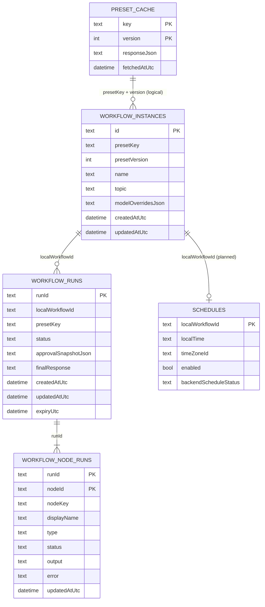
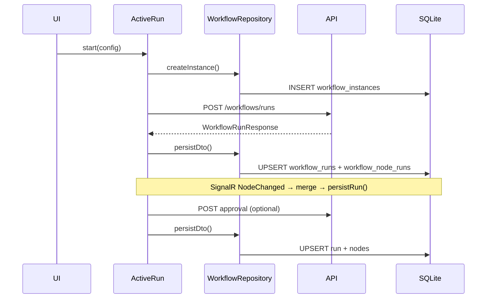

# SQLite schema (mobile)

Local persistence for `arzlyai_mobile` using [Drift](https://drift.simonbinder.eu/) on SQLite. User workflow runs and preset API cache live here. **Credentials are not stored in SQLite** — they use platform secure storage.

See also: [add_preset_flow.md](add_preset_flow.md) for preset UI and workflow execution.

---

## Database file

| Property | Value |
| --- | --- |
| File | `arzlyai.sqlite` |
| Location | Application documents directory (`getApplicationDocumentsDirectory()`) |
| Schema version | `1` (`lib/infrastructor/db/database.dart`) |
| Foreign keys | `PRAGMA foreign_keys = ON` on open (logical relations only — no FK columns in Drift tables yet) |

Provider: `appDatabaseProvider` → `AppDatabase`.

Table definitions: `lib/infrastructor/tables/*.dart`.

---

## What is stored where

| Data | Storage | Why |
| --- | --- | --- |
| Preset catalog + details JSON | SQLite `preset_cache` | Offline catalog, Settings credential discovery |
| Run configuration snapshot | SQLite `workflow_instances` | Local id tied to each started run |
| Run + node execution state | SQLite `workflow_runs`, `workflow_node_runs` | Survive app restarts, SignalR merge, 404 expiry |
| Provider API keys / tokens | Secure storage (`CredentialStore`) | Never in SQLite |
| Backend URL, theme, offline flag | `shared_preferences` | App settings |

---

## Entity relationships

**Logical links (not enforced by SQLite FKs today):**

- `workflow_runs.local_workflow_id` → `workflow_instances.id`
- `workflow_node_runs.run_id` → `workflow_runs.run_id`
- `schedules.local_workflow_id` → `workflow_instances.id`
- `workflow_instances.preset_key` + `preset_version` align with `preset_cache` rows for that preset (not a join key in code)

---

## Tables

### `preset_cache`

Caches raw API JSON for presets so the app can show catalog/details and derive credential requirements without a network call.

| Column | Type | Description |
| --- | --- | --- |
| `key` | TEXT | Preset key, or `_catalog` for the full summary list |
| `version` | INT | Preset version; `0` for catalog row |
| `response_json` | TEXT | Serialized `PresetSummaryResponse` list or `PresetDetailsResponse` |
| `fetched_at_utc` | DATETIME | Last successful fetch time |

**Primary key:** `(key, version)`

**Written by:** `PresetRepository.refreshSummaries()`, `refreshDetails()`

**Read by:** `cachedSummaries()`, `cachedDetails()` → catalog provider, details provider, `credentialRequirementsProvider`

**Special row:** `key = '_catalog'`, `version = 0` holds `GET /api/v1/presets` as a JSON array.

---

### `workflow_instances`

A local record created **once per run start**, before `POST /workflows/runs`. Captures what the user configured (topic, model overrides) and provides a stable local id for linking runs and (future) schedules.

| Column | Type | Description |
| --- | --- | --- |
| `id` | TEXT | UUID v4 — local workflow id |
| `preset_key` | TEXT | API preset key |
| `preset_version` | INT | Preset version at start time |
| `name` | TEXT | Preset display name snapshot |
| `topic` | TEXT | Run input (today: topic string) |
| `model_overrides_json` | TEXT NULL | JSON array of agent override requests |
| `created_at_utc` | DATETIME | |
| `updated_at_utc` | DATETIME | |

**Primary key:** `id`

**Written by:** `WorkflowRepository.createInstance()` (from `active_run_provider.start`)

**Read by:** Indirectly via `workflow_runs.local_workflow_id` when loading runs

---

### `workflow_runs`

Server workflow run state mirrored locally. `run_id` is the backend run id returned from start/approval/GET.

| Column | Type | Description |
| --- | --- | --- |
| `run_id` | TEXT | Backend workflow run id |
| `local_workflow_id` | TEXT | Links to `workflow_instances.id` |
| `preset_key` | TEXT | Redundant copy for listing without join |
| `status` | TEXT | `WorkflowRunStatus` wire value (`running`, `waiting`, `completed`, `failed`, `expired`, …) |
| `approval_snapshot_json` | TEXT NULL | `{ originalContent, currentContent, wasEdited }` when in approval |
| `final_response` | TEXT NULL | Integration/publish result (e.g. post id) |
| `created_at_utc` | DATETIME | |
| `updated_at_utc` | DATETIME | |
| `expiry_utc` | DATETIME NULL | Client-side expiry (30 min from start); used when GET returns 404 |

**Primary key:** `run_id`

**Written by:** `WorkflowRepository.persistDto()`, `persistRun()`, `markExpired()`

**Read by:** `getLocalRun()`, `listLocalRuns()` → `active_run_provider`, execution/review/result screens

**Updates:** SignalR `NodeChanged` events merge into memory then `persistRun()`; `recover()` refetches from API; 404 marks run `expired`.

---

### `workflow_node_runs`

Per-node execution state for a run. One row per workflow node id from the backend graph.

| Column | Type | Description |
| --- | --- | --- |
| `run_id` | TEXT | Parent run |
| `node_id` | TEXT | Backend workflow node id |
| `node_key` | TEXT | Node key from preset graph |
| `display_name` | TEXT | UI label |
| `type` | TEXT | `Agent`, `HumanApproval`, `Integration`, … |
| `status` | TEXT | `WorkflowNodeStatus` wire value |
| `output` | TEXT NULL | Node output (e.g. generated post text) |
| `error` | TEXT NULL | Failure message |
| `updated_at_utc` | DATETIME | |

**Primary key:** `(run_id, node_id)`

**Written by:** `_upsertRun()` alongside parent run (insert on conflict update per node)

**Read by:** Loaded with parent run in `getLocalRun()` / `listLocalRuns()`

---

### `schedules`

Schema for **future** recurring runs per local workflow instance (daily time, timezone, enabled flag, backend sync status).

| Column | Type | Description |
| --- | --- | --- |
| `local_workflow_id` | TEXT | One schedule row per instance |
| `local_time` | TEXT | Local time string (e.g. `09:00`) |
| `time_zone_id` | TEXT | IANA timezone id |
| `enabled` | BOOL | Default `false` |
| `backend_schedule_status` | TEXT NULL | Server registration status when implemented |

**Primary key:** `local_workflow_id`

**Status:** Table is created on first install; **no repository or UI writes yet**. Reserved for scheduled preset runs.

---

## Lifecycle (typical run)

1. User configures run → `createInstance()` inserts `workflow_instances`.
2. API returns `run_id` → `workflow_runs` + initial `workflow_node_runs` rows.
3. Hub events update nodes in place until `waiting`, `completed`, or `failed`.
4. Approval/publish updates approval snapshot and final response columns.
5. If remote GET returns 404 after expiry → `markExpired()` updates status only.

---

## Repositories and providers

| Table | Repository | Key providers |
| --- | --- | --- |
| `preset_cache` | `PresetRepository` | `presetCatalogProvider`, `presetDetailsProvider`, `credentialRequirementsProvider` |
| `workflow_instances` | `WorkflowRepository` | `activeRunProvider` (create only) |
| `workflow_runs` | `WorkflowRepository` | `activeRunProvider`, `selectedRunIdProvider` |
| `workflow_node_runs` | `WorkflowRepository` | `activeRunProvider` |
| `schedules` | — | Not wired yet |

---

## Adding a column or table

1. Edit or add a file under `lib/infrastructor/tables/`.
2. Register the table in `lib/infrastructor/db/database.dart` `@DriftDatabase(tables: [...])`.
3. Bump `schemaVersion` and implement `onUpgrade` in `MigrationStrategy`.
4. Run codegen (when asked): `dart run build_runner build --delete-conflicting-outputs`
5. Update repository upsert/read logic and domain mappers if needed.

Do not store secrets in new columns — keep credentials in `CredentialStore`.

---

## Inspection

On a connected device/emulator, the DB file lives in the app’s documents directory. For local debugging you can copy it off the device or use Drift’s `AppDatabase.forTesting(NativeDatabase.memory())` in tests (`test/repositories/workflow_repository_test.dart`).

---

## Quick reference

| Question | Answer |
| --- | --- |
| Where is the LinkedIn post text during a run? | `workflow_node_runs.output` on the writer/approval node |
| Where is approval draft while editing? | Riverpod temp (`reviewDraftTempProvider`) — not SQLite |
| How does offline catalog work? | Last `preset_cache` rows; catalog provider falls back to cache when refresh fails |
| Can I delete `workflow_instances`? | No cascade today; orphans possible if instances deleted without runs |
| Are runs tied to presets? | `preset_key` on instance and run; details from `preset_cache` |
