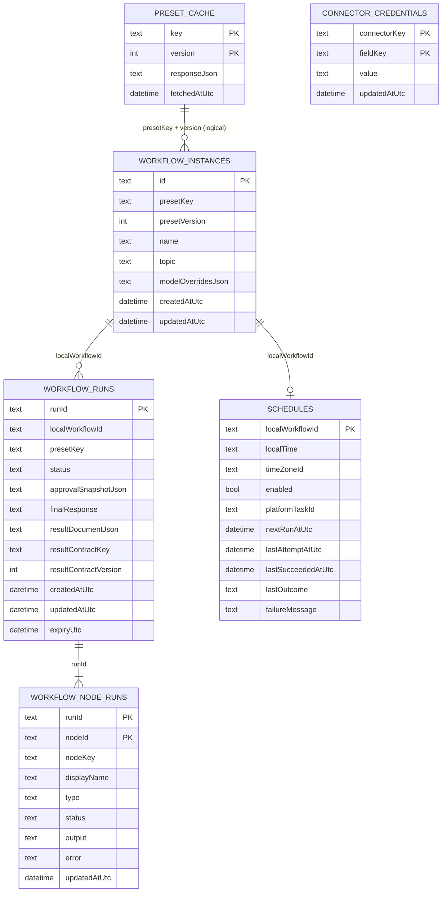
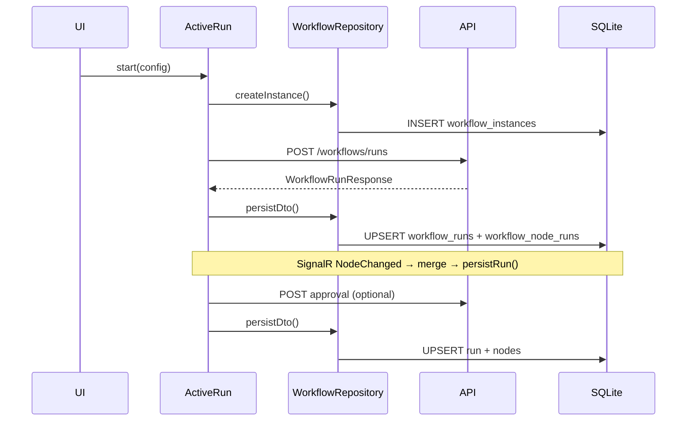
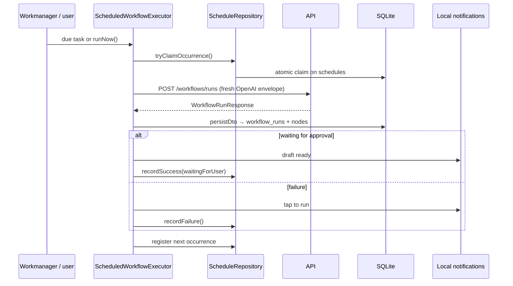

# SQLite schema (mobile)

Local persistence for `arzlyai_mobile` using [Drift](https://drift.simonbinder.eu/) on SQLite. Workflow runs, schedules, preset cache, and connector sync fields live here. **Provider API keys (OpenAI, etc.) are not stored in SQLite** — they use platform secure storage.

See also: [add_preset_flow.md](add_preset_flow.md) for preset UI and workflow execution.

---

## Database file

| Property | Value |
| --- | --- |
| File | `arzlyai.sqlite` |
| Location | Application documents directory (`getApplicationDocumentsDirectory()`) |
| Schema version | `2` (`lib/infrastructor/db/database.dart`) |
| Foreign keys | `PRAGMA foreign_keys = ON` on open (logical relations only — no FK columns in Drift tables yet) |

Provider: `appDatabaseProvider` → `AppDatabase`.

Table definitions: `lib/infrastructor/tables/*.dart`.

---

## What is stored where

| Data | Storage | Why |
| --- | --- | --- |
| Preset catalog + details JSON | SQLite `preset_cache` | Offline catalog, Settings credential discovery |
| Run configuration snapshot | SQLite `workflow_instances` | Local id tied to each workflow instance |
| Run + node execution state | SQLite `workflow_runs`, `workflow_node_runs` | Survive app restarts, SignalR merge, 404 expiry |
| Device-owned schedules | SQLite `schedules` | Wall-clock time, next run, claim/outcome state — no backend schedule API |
| LinkedIn connector envelope fields | SQLite `connector_credentials` | Nango sync result for approval/publish envelopes |
| OpenAI / provider API keys | Secure storage (`CredentialStore`) | Never in SQLite |
| Backend URL, theme, offline flag | `shared_preferences` | App settings |

---

## Entity relationships

**Logical links (not enforced by SQLite FKs today):**

- `workflow_runs.local_workflow_id` → `workflow_instances.id`
- `workflow_node_runs.run_id` → `workflow_runs.run_id`
- `schedules.local_workflow_id` → `workflow_instances.id`
- `workflow_instances.preset_key` + `preset_version` align with `preset_cache` rows for that preset (not a join key in code)
- `connector_credentials` is keyed by connector — not joined to workflow tables

---

## Tables

### `preset_cache`

Caches raw API JSON for presets so the app can show catalog/details and derive credential requirements without a network call.

| Column | Type | Description |
| --- | --- | --- |
| `key` | TEXT | Preset key, or `_catalog` for the full summary list |
| `version` | INT | Preset version; `0` for catalog row |
| `response_json` | TEXT | Serialized `PresetSummaryResponse` list or `PresetDetailsResponse` |
| `fetched_at_utc` | DATETIME | Last successful fetch time |

**Primary key:** `(key, version)`

**Written by:** `PresetRepository.refreshSummaries()`, `refreshDetails()`

**Read by:** `cachedSummaries()`, `cachedDetails()` → catalog provider, details provider, `credentialRequirementsProvider`

**Special row:** `key = '_catalog'`, `version = 0` holds `GET /api/v1/presets` as a JSON array.

---

### `workflow_instances`

A local workflow configuration record. One row per configured preset workflow the user can run or schedule. Provides a stable local id for linking runs and schedules.

| Column | Type | Description |
| --- | --- | --- |
| `id` | TEXT | UUID v4 — local workflow id |
| `preset_key` | TEXT | API preset key |
| `preset_version` | INT | Preset version at start time |
| `name` | TEXT | Preset display name snapshot |
| `topic` | TEXT | Run input (today: topic string) |
| `model_overrides_json` | TEXT NULL | JSON array of agent override requests |
| `created_at_utc` | DATETIME | |
| `updated_at_utc` | DATETIME | |

**Primary key:** `id`

**Written by:** `WorkflowRepository.createInstance()` (foreground start and schedule setup)

**Read by:** `WorkflowRepository.getInstance()`, scheduled executor, schedule providers

---

### `workflow_runs`

Server workflow run state mirrored locally. `run_id` is the backend run id returned from start/approval/GET.

| Column | Type | Description |
| --- | --- | --- |
| `run_id` | TEXT | Backend workflow run id |
| `local_workflow_id` | TEXT | Links to `workflow_instances.id` |
| `preset_key` | TEXT | Redundant copy for listing without join |
| `status` | TEXT | `WorkflowRunStatus` wire value (`running`, `waiting`, `completed`, `failed`, `expired`, …) |
| `approval_snapshot_json` | TEXT NULL | `{ originalContent, currentContent, wasEdited }` when in approval |
| `final_response` | TEXT NULL | Integration/publish result (e.g. post id) or legacy string fallback |
| `result_document_json` | TEXT NULL | Serialized `arzly.report` document when present |
| `result_contract_key` | TEXT NULL | Result contract key (e.g. `arzly.report`) |
| `result_contract_version` | INT NULL | Result contract version |
| `created_at_utc` | DATETIME | |
| `updated_at_utc` | DATETIME | |
| `expiry_utc` | DATETIME NULL | Client-side expiry (30 min from start); used when GET returns 404 |

**Primary key:** `run_id`

**Written by:** `WorkflowRepository.persistDto()`, `persistRun()`, `markExpired()`

**Read by:** `getLocalRun()`, `listLocalRuns()` → `active_run_provider`, execution/review/result screens

**Updates:** SignalR `NodeChanged` events merge into memory then `persistRun()`; `recover()` refetches from API; 404 marks run `expired`.

---

### `workflow_node_runs`

Per-node execution state for a run. One row per workflow node id from the backend graph.

| Column | Type | Description |
| --- | --- | --- |
| `run_id` | TEXT | Parent run |
| `node_id` | TEXT | Backend workflow node id |
| `node_key` | TEXT | Node key from preset graph |
| `display_name` | TEXT | UI label |
| `type` | TEXT | `Agent`, `HumanApproval`, `Integration`, … |
| `status` | TEXT | `WorkflowNodeStatus` wire value |
| `output` | TEXT NULL | Node output (e.g. generated post text) |
| `error` | TEXT NULL | Failure message |
| `updated_at_utc` | DATETIME | |

**Primary key:** `(run_id, node_id)`

**Written by:** `_upsertRun()` alongside parent run (insert on conflict update per node)

**Read by:** Loaded with parent run in `getLocalRun()` / `listLocalRuns()`

---

### `schedules`

Device-owned recurring schedule for a local workflow instance. SQLite is the sole source of truth — the backend has no schedule endpoints. Workmanager and local notifications are registered from this row; execution still uses `POST /workflows/runs` when due.

| Column | Type | Description |
| --- | --- | --- |
| `local_workflow_id` | TEXT | One schedule per instance; links to `workflow_instances.id` |
| `local_time` | TEXT | User wall-clock time (`HH:mm`) |
| `time_zone_id` | TEXT | IANA timezone captured from the device |
| `enabled` | BOOL | Default `false` — future occurrences active when true |
| `platform_task_id` | TEXT NULL | Stable Workmanager unique name (e.g. `workflow:<localWorkflowId>`) |
| `next_run_at_utc` | DATETIME | Next calculated occurrence in UTC |
| `last_attempt_at_utc` | DATETIME NULL | Last claim/attempt time (retry and diagnostics) |
| `last_succeeded_at_utc` | DATETIME NULL | Last successful occurrence boundary (duplicate prevention) |
| `last_outcome` | TEXT NULL | `started`, `waitingForUser`, `failed`, or `skipped` |
| `failure_message` | TEXT NULL | Sanitized error text — never credentials or envelope data |

**Primary key:** `local_workflow_id`

**Written by:** `ScheduleRepository` (`upsert`, `recordSuccess`, `recordFailure`, `tryClaimOccurrence`)

**Read by:** `WorkflowScheduler`, `ScheduledWorkflowExecutor`, `schedule_providers`, `AppScheduleSection`

**Outcomes (`ScheduleOutcomes`):**

| Value | Meaning |
| --- | --- |
| `started` | Run started; not waiting for approval |
| `waitingForUser` | Generation finished at human approval — user must open app |
| `failed` | Background/foreground attempt failed; tap-to-run notification shown |
| `skipped` | Pending approval already exists; no overlapping generation |

**Notes:**

- Scheduled generation uses OpenAI credentials only; LinkedIn credentials are required only when the user accepts the draft.
- Encrypted credential envelopes are never stored in this table.
- Disabling or deleting a schedule cancels the Workmanager task and pending reminder notification.

---

### `connector_credentials`

LinkedIn connector fields synced from the Nango-backed API after connect. Mapped to integration envelope keys at approval time. OpenAI keys are **not** stored here.

| Column | Type | Description |
| --- | --- | --- |
| `connector_key` | TEXT | Connector id (e.g. `linkedin`) |
| `field_key` | TEXT | Field name within the connector (e.g. `accessToken`, `authorUrn`) |
| `value` | TEXT | Field value from sync |
| `updated_at_utc` | DATETIME | Last write time |

**Primary key:** `(connector_key, field_key)`

**Written by:** `ConnectorCredentialRepository.saveFields()` after `ConnectorRepository.syncCredentials()`

**Read by:** `CredentialRepository.readForPreset()` during approval Accept; `ConnectorCredentialRepository.isConnected()`

**Cleared by:** `ConnectorRepository.disconnect()` on successful disconnect

---

## Lifecycle (typical run)

1. User configures run → `createInstance()` inserts `workflow_instances`.
2. API returns `run_id` → `workflow_runs` + initial `workflow_node_runs` rows.
3. Hub events update nodes in place until `waiting`, `completed`, or `failed`.
4. Approval/publish updates approval snapshot and final response columns.
5. If remote GET returns 404 after expiry → `markExpired()` updates status only.

---

## Lifecycle (scheduled run)

1. User enables schedule on configure screen → `schedules` upsert + Workmanager one-off task + reminder notification.
2. On due time, executor claims the occurrence atomically to prevent duplicate API calls.
3. If a run is already `waiting`, claim path records `skipped` and prompts review instead of regenerating.
4. On success at approval, next `next_run_at_utc` is calculated with timezone-aware wall-clock math.
5. App launch/resume reconciles enabled schedules with platform registration.

---

## Repositories and providers

| Table | Repository | Key providers |
| --- | --- | --- |
| `preset_cache` | `PresetRepository` | `presetCatalogProvider`, `presetDetailsProvider`, `credentialRequirementsProvider` |
| `workflow_instances` | `WorkflowRepository` | `activeRunProvider`, `scheduledWorkflowExecutorProvider` |
| `workflow_runs` | `WorkflowRepository` | `activeRunProvider`, `selectedRunIdProvider` |
| `workflow_node_runs` | `WorkflowRepository` | `activeRunProvider` |
| `schedules` | `ScheduleRepository` | `schedule_providers`, `AppScheduleSection` |
| `connector_credentials` | `ConnectorCredentialRepository` | `connectorConnectProvider`, `CredentialRepository` (approval) |

---

## Adding a column or table

1. Edit or add a file under `lib/infrastructor/tables/`.
2. Register the table in `lib/infrastructor/db/database.dart` `@DriftDatabase(tables: [...])`.
3. Bump `schemaVersion` in `database.dart`. During dev there is no `onUpgrade` — uninstall the app and reinstall (or clear app data) so `onCreate` runs again.
4. Run codegen (when asked): `dart run build_runner build --delete-conflicting-outputs`
5. Update repository upsert/read logic and domain mappers if needed.

Do not store secrets in new columns — keep provider API keys in `CredentialStore`. Connector envelope fields from Nango sync may live in `connector_credentials` per existing pattern.

---

## Inspection

On a connected device/emulator, the DB file lives in the app’s documents directory. For local debugging you can copy it off the device or use Drift’s `AppDatabase.forTesting(NativeDatabase.memory())` in tests (`test/repositories/workflow_repository_test.dart`).

---

## Quick reference

| Question | Answer |
| --- | --- |
| Where is the completed Smart Buy report? | `workflow_runs.result_document_json` (+ contract key/version); mapped to `ArzlyReport` in domain layer |
| Where is the LinkedIn post text during a run? | `workflow_node_runs.output` on the writer/approval node |
| Where is approval draft while editing? | Riverpod temp (`reviewDraftTempProvider`) — not SQLite |
| How does offline catalog work? | Last `preset_cache` rows; catalog provider falls back to cache when refresh fails |
| Where are schedules stored? | `schedules` — device-owned; backend has no schedule API |
| What happens when a schedule is due? | Workmanager runs executor → `POST /workflows/runs` → draft-ready notification at approval |
| Where is LinkedIn token for publish? | `connector_credentials` (synced from Nango); OpenAI key stays in secure storage |
| Can I delete `workflow_instances`? | No cascade today; orphans possible if instances deleted without runs |
| Are runs tied to presets? | `preset_key` on instance and run; details from `preset_cache` |
